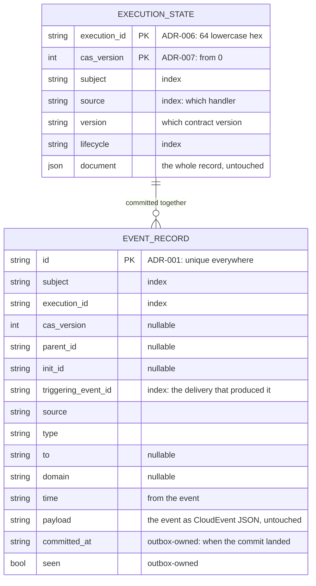
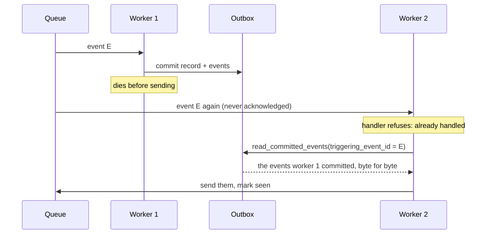

# ADR-019: The Outbox

- **Status:** Accepted
- **Date:** 2026-10-26
- **Scope:** Arvo ecosystem
- **Amends:** [ADR-006](./006-arvoeventhandler-protocol.md), **Required of infrastructure adapters** — one additive paragraph: a mechanism MAY meet obligations 2 and 5, and the preserving half of obligation 1, through an outbox as defined here; the publishing half of obligation 1 remains the mechanism's, carried out through the outbox's send operations. Additive: nothing already there is replaced
- **Depends on:** [ADR-006](./006-arvoeventhandler-protocol.md), three of whose five obligations on a mechanism this ADR gives a durable shape to; [ADR-007](./007-execution-record.md), which defines the record an outbox holds and the `cas_version` it compares; [ADR-008](./008-execution-faults-and-abandonment.md), whose abandonment pair an outbox must be able to commit in every shape the fault carries it; [ADR-010](./010-delivery-classification-and-entry-validation.md), whose gate makes a repeated delivery safe to discard, which is what lets an outbox resend without harm; [ADR-001](./001-arvoevent-structure.md), which makes an event's `id` unique everywhere; [ADR-003](./003-arvoevent-cloudevent-transformation.md), whose CloudEvent form is what an outbox stores an event as; [ADR-004](./004-multi-language-implementation-governance.md), which leaves API shape to each language; [ADR-015](./015-no-ordering-guarantee.md), which forbids any party from promising order
- **Addresses, in part:** [ADR-000](./000-arvo-system-identity-and-architectural-principles.md) Deferred Decisions — "Infrastructure adapter interfaces and conformance", the persistence adapter; [ADR-017](./017-dispatcher.md) **Left deferred** — "how a mechanism commits the record and the events"
- **Left deferred:** where events wait, who moves them, retry, abandonment policy, how a repeated opening event is treated, what an operator watches, retention, conformance tests, canonical wire serialization. See **Left deferred**

Conformance language is as defined in [ADR-000](./000-arvo-system-identity-and-architectural-principles.md).

## Terminology

- **State** — the execution record of [ADR-007](./007-execution-record.md), exactly as that ADR defines it. It is called *state* in this ADR's data model because that is what a mechanism keeps between deliveries; *record* and *state* name one thing here.
- **Queue** — wherever events wait for a worker to deliver them. It is infrastructure, outside this ADR and outside the outbox, as ADR-006 leaves it.
- **Sweeper** — whatever asks the outbox for events not yet sent, puts them on the queue, and marks them seen. It is the mechanism's, not the outbox's.

## Scope

### What this ADR defines

The **outbox**: the one durable piece Arvo offers so that a mechanism need not build its own. A mechanism MAY use it; one built on something that already meets ADR-006's obligations need not. What it holds — each execution's state and every event committed with it. The operations it offers, what each must do, and what each may refuse. How a crashed delivery is recovered from it. What it never does. And the one promise that makes it an outbox rather than a store: **once a state and its events are committed together, the outbox can always say which of those events have not yet left, and hands them back exactly as committed, so that a crash costs a resend and never a regeneration.**

This ADR is written so that someone who has never read another Arvo record can implement an outbox against their own database and get it right.

### What this ADR deliberately does not define

- **API shape.** Method names, whether operations take one argument or several, how the implementation reports failure. Each language's own choice ([ADR-004](./004-multi-language-implementation-governance.md)). The names used here are the model's and illustrative.
- **How Arvo calls an outbox.** The party on Arvo's side that builds what an outbox stores, checks what it returns, and turns its failures into Arvo's own is [ADR-020](./020-outbox-driver.md).
- **Where events wait, and who sends them.** An outbox is not a queue and sends nothing. Where an event waits for a worker, who puts it there, and who takes it from there, is the mechanism's, as ADR-006 leaves it. The outbox only answers what has not been sent and records what has.
- **Retention.** How long an outbox keeps what it holds is the deployment's. This ADR says what a deletion costs and nothing more.
- **How an outbox is built.** This ADR names no storage technology, no table layout and no technique. Every rule is a behaviour an implementation can be tested against.

### How this ADR changes

Once accepted, this ADR changes only by a superseding ADR. It is not amended in place.

## Context

### Five obligations with no shape

ADR-006 places five obligations on whatever runs a handler: preserve the record and the events together and publish the events at least once; answer the state function live; abandon only with the pair as handed; make every retry a fresh delivery; serialize writes to one record through `cas_version` ([ADR-006](./006-arvoeventhandler-protocol.md), **Required of infrastructure adapters**). Two of the five, and half of a third, are about one durable thing: the place the record and the events are kept. ADR-006 deliberately gave that thing no shape, so that no database would be named.

The result is that every mechanism writes it again. Each one writes the compare-and-swap, the all-or-nothing commit, the recovery read, and the publish-after-commit, and each one can get any of them subtly wrong in a way only its own conformance tests would catch. The behaviour the five obligations require is the same everywhere; only the database differs.

### What a mechanism actually needs from storage

Read a state live. Write a state and its events together, refusing a stale write. Read back what one delivery committed. Find what was committed but not yet sent. Say what has been sent. Nothing else touches storage: routing, retry and abandonment read the outbox's answers but write nothing of their own.

That is a small, fixed surface, and it is the same surface under every database. Naming it lets a database adapter be written once per database rather than once per mechanism, and lets Arvo check it once.

### Why this is a model-level decision

ADR-004 says a decision that is "really a new model-level behavioral commitment" belongs in an ADR. What an outbox must guarantee — together or not at all, resend as committed, compare-and-swap on the record's own revision — is exactly such a commitment: a record committed by an outbox in one language must be readable and recoverable by a mechanism in another, and both must refuse the same stale write. The data model and the rules are the commitment. The method names are not, and are left to each language.

## Decision

### An outbox holds two things

**An outbox holds, for every execution it keeps, the execution's latest state; and for every delivery it keeps, the events that delivery produced, exactly as committed.** How long it keeps either is the deployment's (**Retention**). The two are joined: a commit writes a state and its events as one unit.



#### The execution state

One row per revision of one execution, or the latest revision only. The outbox receives the record as one JSON document, exactly as ADR-007 defines it, and stores it whole. Every other field below arrives as a plain value beside it, on the commit.

| Field | From | Role |
|---|---|---|
| `execution_id` | the commit | **key**, with `cas_version`. ADR-006 derives it and makes it unique everywhere, so many handlers share one outbox and nothing is keyed by handler |
| `cas_version` | the commit | **key**, with `execution_id`; compared on every commit |
| `subject`, `source`, `version`, `lifecycle` | the commit | indexes an outbox MAY keep, and MAY ignore |
| `document` | the commit | the whole record, as given, returned as given |

**An outbox MUST NOT read anything off the record.** Every value it keys, compares or indexes by arrives beside the record as a plain field. The record is a blob to the outbox, as the event payload is.

#### The event record

One row per event ever committed. The party calling the outbox builds the row ([ADR-020](./020-outbox-driver.md)); the outbox never opens the payload, just as it never opens the record.

| Field | From | Role |
|---|---|---|
| `id` | the event | **key**; unique everywhere under ADR-001 |
| `subject` | the event | index: every event of one workflow |
| `execution_id` | the event | index: every event one execution committed |
| `cas_version` | the commit | the record revision it was committed with; **null where the event was committed with no record** |
| `parent_id`, `init_id` | the event | causality, as ADR-001 defines them |
| `triggering_event_id` | the delivered event's `id` | index: the delivery that produced it. **This is what recovery reads by** |
| `source`, `type`, `to`, `domain`, `time` | the event | indexes an outbox MAY keep, and MAY ignore |
| `payload` | the event, in CloudEvent form | the event as a CloudEvent per ADR-003, written as JSON; byte for byte as committed |
| `committed_at` | the outbox | when the commit landed, by the outbox's clock |
| `seen` | the outbox | whether a queue has accepted it; `false` on commit |

Two fields are the outbox's own. **`committed_at` MUST be set once, as part of the commit it belongs to, by the outbox's own clock and never the caller's.** `seen` MUST change only through the mark-seen operation.

#### What the payload is

**The payload MUST be the event in CloudEvent form, as [ADR-003](./003-arvoevent-cloudevent-transformation.md) defines the transformation, written as a JSON string.** The outbox is where an event leaves the model for the queue, and ADR-003 fixes CloudEvents as the form an event takes outside Arvo, so what is stored is what is sent, and a sweeper puts the string on the queue exactly as it is. The party calling the outbox converts in both directions ([ADR-020](./020-outbox-driver.md)); the outbox never does.

Every language implementation already has ADR-003's transformation, because ADR-000 binds transformability to the model, so a payload stored by one language is readable by another with nothing new required. This ADR fixes the form and not the bytes: ADR-003's deferred *canonical wire serialization* stays deferred, and recovery needs only that an outbox hands back the bytes it was given.

The record inside the state holds events in ADR-007's own shape, and the payload holds them in CloudEvent form. The two are interchangeable without loss under ADR-003, so the difference is cosmetic and is accepted.

### Six operations

```
read_latest_state(execution_id)              → record | none
commit_state_and_events(commit)              → committed | refused(reason)
commit_events(events)                        → done
read_committed_events(filter)                → events, as committed
list_unseen_events(at_most, older_than)      → events, oldest committed first
mark_events_seen(event_ids)                  → done
```

`commit` is one flat object carrying everything both tables need, so the outbox infers nothing:

```
commit = {
  execution_id, cas_version,                 the key, and the revision to compare
  subject, source, version, lifecycle,       the indexes, to keep or ignore
  state,                                     the record, whole and opaque
  events                                     event records, already built and serialized
}
```

`filter` is one of: one execution, one delivery, or one delivery within one execution. Recovery reads by one delivery, which is one delivery's worth of events. Reading by one execution alone returns everything that execution ever committed, which may be large, and is for inspection rather than for any hot path.

**An outbox MUST offer every one of these, with these behaviours, and SHOULD offer nothing that reaches a delivery.** An outbox MAY be asked read-only questions beyond these, about what it holds.

**An implementer's operations are plain.** They return values and they may throw whatever their database throws. An outbox MUST NOT be required to produce Arvo's faults, results or errors; turning its answers and failures into those is the caller's ([ADR-020](./020-outbox-driver.md)).

### Reading

1. **An outbox MUST read live.** `read_latest_state` reaches what is stored on every call. Nothing may be cached in front of it. This is ADR-006 obligation 2, met.
2. **An outbox MUST return the latest.** Where it keeps history, the highest `cas_version` under the key.
3. **An outbox MUST return the document untouched.** It parses nothing, validates nothing, adds nothing and drops nothing. Untouched means the same JSON value: a store MAY reorder keys or normalise whitespace, and MUST NOT change, add or drop a value. Whether the document is a record, belongs to this event, or can still be resumed is the handler's to judge.

### Committing

4. **A commit MUST land as one unit or not at all.** Everything in one `commit_state_and_events` or one `commit_events` becomes visible together, or none of it does. This is ADR-006 obligation 1, the first half.
5. **The handler sets `cas_version`; the outbox only compares it.** The commit carries it as a plain field:
   - `0` means "the first record of this execution". The outbox MUST commit only if nothing exists under `execution_id`, and MUST otherwise refuse with `state_exists`.
   - Any other value MUST be exactly the stored `cas_version` plus one. The outbox MUST otherwise refuse with `revision_stale`.

   This is ADR-006 obligation 5 and ADR-007 **`cas_version`**, met.
6. **A refusal is an answer, not a failure.** Losing a race is ordinary, and the outbox MUST report it as a value the caller reads. The outbox MUST throw only where it could not do its work at all.
7. **An outbox MUST NOT alter a record or an event record.** Not on the way in, not on the way out, not later. For the record, unaltered means the same JSON value (rule 3). For an event record's `payload`, it means the same bytes (rule 10).
8. **Events MAY be committed with no record.** `commit_events` writes event records whose `cas_version` is null. There is nothing to compare, so it never refuses. This is what ADR-006 obligation 3 needs for a fault that carries an event and no record: "publish the event; no execution began, so there is no record to commit and none is invented".
9. **An event `id` already committed MUST be ignored by the outbox, as part of the same commit.** Both commits treat an event record whose `id` exists as already done: keep what is stored, write nothing for it, and do not fail. Nothing above the outbox checks for duplicates; this rule is the only one.

   The outbox owns this because it is the only place it can be done correctly: a check made anywhere above it is a read and then a write, and two callers racing can both pass the read. Only the outbox can decide inside the commit itself.

### Recovering

10. **An outbox MUST keep each event record's `payload` as committed, byte for byte.** A recovered delivery resends the payload. It never regenerates it. This is what lets a mechanism meet ADR-006 obligation 1's second half.
11. **`read_committed_events` MUST answer from storage.** Given the filter, exactly the event records that were committed, and nothing derived.

### Sending

12. **"Seen" means a queue has it.** An event MUST be marked seen only after it was handed to a queue and the queue acknowledged it, never before.
13. **Nothing is listed before it is committed.** An event appears in `list_unseen_events` only once the commit it belongs to has landed, and only while it is not marked seen. `older_than` leaves out anything whose `committed_at` is more recent than that, so a worker that has just committed has time to send its own events before the sweeper takes them.
14. **Handing the same event to two callers is permitted, and a lease is recommended.** A receiver discards a repeat at the gate ([ADR-010](./010-delivery-classification-and-entry-validation.md), step 9), so correctness never depends on handing an event out once. But several sweepers without a lease all take the same oldest events and all send them. An outbox meant for more than one sweeper SHOULD claim what it hands out, and let the claim lapse where it is never marked seen. **An outbox that leases MAY leave events under a live lease out of what it lists to other callers**; once the lease lapses they are listed again. That is the one way an unseen event may be absent from a list, and it is temporary.
15. **`mark_events_seen` is final and MAY be repeated.** Marking an already-seen event again does nothing.
16. **The queue MUST keep what it accepts.** Once an event is marked seen, the outbox is done with it. A queue that can lose an accepted message does not meet this ADR, and nothing may mark an event seen on its behalf.

### Order

17. **Order is the outbox's, never a promise.** `list_unseen_events` hands events out oldest committed first, so a stranded event goes before a fresh one. Nothing downstream may rely on any order ([ADR-015](./015-no-ordering-guarantee.md)).

### Recovery, in order

The rules above exist to keep this sequence working, and it is the one part of an outbox that is easy to get wrong without seeing it whole.

1. A worker delivers an event. The handler runs. The commit succeeds: the record and the events are now in the outbox.
2. The worker dies before it sends the events, or before it tells the queue the delivery is done.
3. The queue never heard back, so later it delivers the same event again. This may be minutes or hours later, depending on the queue.
4. A new worker runs the handler. The handler reads the record, finds the event's `id` already in `event_ids`, and refuses ([ADR-010](./010-delivery-classification-and-entry-validation.md), step 9; or `record_unexpected` for an init). That refusal is correct.
5. The new worker still has to finish what the first did not: send the events. It may not run the handler again to get them. It reads them back, `read_committed_events` by this delivery's `triggering_event_id`, and sends exactly those bytes.



Step 5 only works if the event records are still there, and only if they are exactly what was committed. Rules 10 and 11 are why.

### Retention

**This ADR fixes no retention.** How long an outbox keeps event records and old record revisions, and when it deletes them, is the deployment's, and nothing in Arvo depends on any answer. Two facts bear on the choice:

- A late redelivery recovers through step 5 above. An event record deleted before a redelivery of its delivery can still arrive leaves that step with nothing to resend, while the record says the work was done. "Seen" alone is not a safe signal to delete on: it says a queue took the events, not that the delivery was acknowledged.
- Only the latest record revision is ever read.

### What an outbox is not

- **Not a queue.** Where an event waits for a worker is a different thing, and ADR-006 leaves it with the mechanism. An outbox says what was committed and whether a queue has taken it.
- **Not a router.** It MUST NOT decide anything from `to` or `domain`. They are kept for indexing.
- **Not a judge.** It MUST NOT decide whether a record is valid, whether an execution is finished, or whether to retry.
- **Not a parser.** It reads nothing off the record and nothing off an event payload. Every value it uses arrives as a field.

## Consequences

### Gained

- The storage half of ADR-006's obligations has one durable shape, met once per database rather than once per mechanism, and checkable once.
- A state and its events committed in one language are readable and recoverable by a mechanism in another: the data model and the compare-and-swap rule are the same everywhere, and the payload is in the one form every implementation can already read. This is the property ADR-004 exists to secure.
- An implementer who knows their database and nothing of Arvo can write a conforming outbox from this record alone: plain operations, values returned, failures thrown.
- Abandonment in every shape ADR-008 defines has a write: with a record, or events alone.
- Recovery is a read of committed bytes, so nothing here requires an executor to be deterministic, as ADR-006 already relies on.

### Paid for

- **Every event is stored twice over in spirit:** once in the record's `event_ids` and once as an event record. Accepted because the first is the handler's memory and the second is what recovery resends, and neither can stand in for the other.
- **An outbox that keeps history grows without bound** until the deployment decides otherwise. Accepted because the alternative, a retention rule in the model, would name a number no ADR can know.
- **A duplicate hand-out is permitted,** so a deployment without leases does more sending than it needs to. Accepted because correctness must never depend on exactly-once, which ADR-010's gate already secures.
- **The outbox is a second party that must be conformance-tested** beside the handler. Accepted because it replaces the same tests written per mechanism.
- **One event appears in two spellings inside one store:** ADR-007's inside the state, CloudEvent inside the payload. Accepted because the two are interchangeable without loss, the state is the handler's and the payload is the queue's, and converting the state's events would amend ADR-007 for a cosmetic gain.
- **Storage is tied to ADR-003.** A change to the CloudEvent transformation reaches every stored payload. Accepted because ADR-003 changes only by supersession, so the risk is governed rather than drifting.

## Considered Alternatives

### Leaving storage to each mechanism

Considered: no ADR, each mechanism keeping its own tables. Rejected because the behaviour is fixed by ADR-006 already and differs nowhere; only the database differs. Writing it per mechanism multiplies the places it can be wrong without multiplying anything that varies.

### An outbox that is also the queue

Considered: the outbox holding where events wait, with claims and leases, so that one component does both. Rejected because it makes every outbox a queue, which most databases are poor at and which ADR-006 leaves with the mechanism on purpose, and because a deployment with a real queue would then have two.

### Parsed records in and out

Considered: the outbox receiving and returning the record as the implementation's own typed object. Rejected because it pulls Arvo's types into every outbox, requires an implementer to understand the record, and contradicts ADR-006 obligation 2, which has the state function "validate nothing beyond parsing" and leaves judgement to the handler.

### The outbox reading its keys off the record

Considered: the outbox reading `execution_id`, and the index fields, out of the record document itself, so the commit carries less. Rejected because it makes every outbox a reader of ADR-007's record shape, so a change to that shape reaches every database adapter, and because it is a second copy of the one mapping the driver already owns. Lifting every field onto the commit costs a few values per call and keeps the record a blob.

### The payload in the event's own JSON shape

Considered: storing the payload as the event's own fields written as JSON, ADR-001's shape, and converting to a CloudEvent only where a transport wants one. Rejected because the outbox is where an event leaves the model, ADR-003 fixes the form it leaves in, and storing that form means a sweeper sends the stored bytes untouched, so what was committed is what is sent. The state's own events stay in ADR-001's shape, under ADR-007.

### A refusal as a thrown error

Considered: losing a compare-and-swap race reported as an exception. Rejected because losing a race is ordinary and expected, a thrown error says the outbox could not do its work, and an implementer who conflates the two makes the caller unable to tell a stale write from a broken database.

### Deduplicating above the outbox

Considered: the caller removing already-committed events before a commit. Rejected under rule 9: it is a read and then a write, so two racing callers can both pass it, where the outbox can decide inside the commit.

### A second flag for "handled"

Considered: the outbox also recording when a receiving handler finished with each event, for visibility and recovery from a lossy queue. Rejected because the flag would lag reality and so could never be trusted for correctness, because it works only within one outbox, and because rule 16 already requires a queue that keeps what it accepts.

## Conformance to ADR-000

### Effect on AAM

None to the membership list. The outbox is an infrastructure adapter under ADR-000's own term, "an integration binding the model to … persistence", and this ADR gives one such adapter its interface, which ADR-000 defers under "Infrastructure adapter interfaces and conformance". The record it holds is ADR-007's, unchanged.

### Invariants depended on

- **Infrastructure Independence.** This ADR names no database and requires none. Every rule is a behaviour.
- **Explicit Contracts and Runtime Validation.** What an outbox returns is checked before Arvo trusts it ([ADR-020](./020-outbox-driver.md)); nothing is trusted because of where it was stored.
- **Event-Only Communication.** An outbox adds no control path. It holds events and records and answers questions about them.

### Invariants strained

- **Infrastructure Independence,** mildly: an outbox requires a store that can commit two writes as one unit and compare a value inside that unit. ADR-006 already requires both of any conforming mechanism ("one that cannot compare-and-swap cannot claim conformance at all"), so nothing new is asked.

### Required of infrastructure adapters

One thing added to ADR-006 **Required of infrastructure adapters**, additively: **a mechanism MAY meet obligations 2 and 5, and the preserving half of obligation 1, through an outbox conforming to this ADR**, and where it does, the outbox meets them on its behalf. The publishing half of obligation 1, that every committed event reaches its destination at least once, remains the mechanism's: it is met only where the mechanism runs a sweeper against `list_unseen_events` and `mark_events_seen`, and an outbox alone meets no part of it. Obligations 3 and 4, abandonment and retry, remain the mechanism's policy, written against the outbox's operations. A mechanism MUST NOT mark an event seen on behalf of a queue that can lose it (rule 16).

### Left deferred

- **Where events wait, and who moves them.** The queue, the sweeper, and the loop that delivers. ADR-006 leaves them with the mechanism; a later ADR is the place.
- **What a mechanism does with each refusal.** Re-read and run again, retry later, give up: policy, the mechanism's, for a later ADR.
- **How a mechanism treats a repeated opening event.** Recovery step 4 has the handler refuse it as `record_unexpected`, a fault; ADR-010 permits a mechanism to treat that as a repeat rather than a failure, and the recovery sequence assumes it does. Which it does, and when, is policy, for a later ADR.
- **What an operator watches.** The one number this ADR makes available is how many events are unseen and older than the grace period: near zero when healthy, growing when a sweeper has stalled or a queue refuses events. Publishing it is the mechanism's, for a later ADR.
- **Retention.** Deliberately the deployment's.
- **Conformance tests for an outbox.** The next piece of work after this ADR is accepted: a suite every outbox implementation runs, as ADR-004 asks of every protocol piece.
- **Canonical wire serialization.** This ADR fixes the payload's form and not its bytes. Byte-for-byte canonical JSON stays where ADR-003 left it.

## Appendix: An illustrative surface

Not normative. One way the operations could look, in no particular language. `EventRecord` is the event record of **The event record**, with every field it lists.

```
interface Outbox
  read_latest_state(execution_id: string): json | none

  commit_state_and_events(commit: {
    execution_id: string, cas_version: integer,
    subject: string, source: string, version: string, lifecycle: string,
    state: json,
    events: list of EventRecord
  }): Committed | Refused(reason: 'state_exists' | 'revision_stale')

  commit_events(events: list of EventRecord): nothing

  read_committed_events(
    filter: { execution_id } | { triggering_event_id } | { execution_id, triggering_event_id }
  ): list of EventRecord + committed_at + seen

  list_unseen_events(at_most: integer, older_than: duration): list of EventRecord + committed_at + seen

  mark_events_seen(event_ids: list of string): nothing
```

