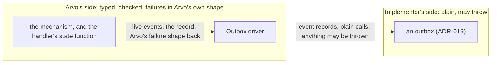
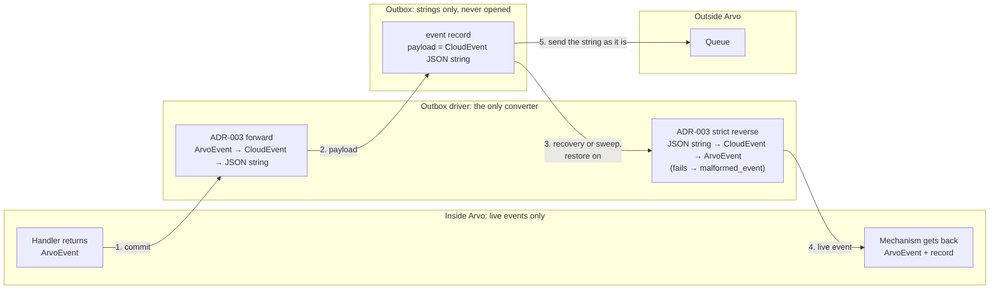
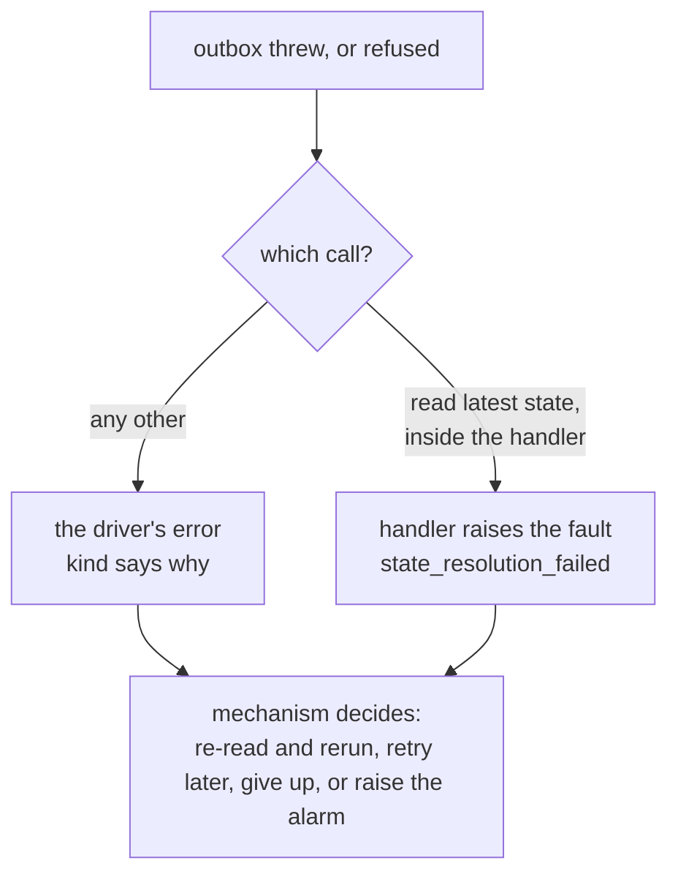

# ADR-020: The Outbox Driver

- **Status:** Accepted
- **Date:** 2026-10-26
- **Scope:** Arvo ecosystem
- **Amends:** nothing. Every rule here is new
- **Depends on:** [ADR-019](./019-outbox.md), which defines the outbox this ADR puts one party in front of; [ADR-006](./006-arvoeventhandler-protocol.md), which defines the state function a handler is given and the fault a handler raises where that function fails; [ADR-008](./008-execution-faults-and-abandonment.md), which fixes what a fault is and so what this ADR's error is not; [ADR-003](./003-arvoevent-cloudevent-transformation.md), whose transformation this party applies in both directions; [ADR-018](./018-trace-context-across-layers.md), which fixes how a party that carries an event joins its trace, and so what this party, which carries none, is not
- **Addresses, in part:** [ADR-000](./000-arvo-system-identity-and-architectural-principles.md) Deferred Decisions — "Infrastructure adapter interfaces and conformance", how the model side meets an adapter
- **Left deferred:** what a mechanism does with each failure the driver reports; how a handler's state function is built from the driver's read; the span's name and attributes; conformance tests. See **Left deferred**

Conformance language is as defined in [ADR-000](./000-arvo-system-identity-and-architectural-principles.md).

## Scope

### What this ADR defines

The **outbox driver**: the one party on Arvo's side that calls an outbox. What it does on the way in — turning what a handler returned into what an outbox stores. What it does on the way out — checking what an outbox returned before anything in Arvo trusts it. How it reports failure, as one error whose kind says why. Where a failure can become a fault, and where it does not. And what it must never decide.

### What this ADR deliberately does not define

- **API shape.** Whether the driver is a class or a set of functions; what its operations are called; how it reports failure in each language's idiom. Each language's own choice ([ADR-004](./004-multi-language-implementation-governance.md)).
- **The outbox.** [ADR-019](./019-outbox.md).
- **Policy.** Whether to re-read and run again, retry later, or give up when the driver reports a failure. The mechanism's, and a later ADR's.
- **The driver's span name and attributes.** API shape, as ADR-018 already says of every party.

### How this ADR changes

Once accepted, this ADR changes only by a superseding ADR. It is not amended in place.

## Context

### Two sides that must look different

ADR-019 makes an outbox deliberately plain: an implementer returns values and throws whatever their database throws, and is never asked to produce Arvo's faults, results or errors. That is what makes an outbox writable by someone who knows only their database.

Arvo's side needs the opposite. ADR-000 requires runtime validation of everything crossing a boundary; ADR-006 requires the handler's state function to yield "absence or a parsed JSON object" and nothing else; ADR-008 fixes how a failure inside a delivery is represented. Something has to stand between the two sides and translate, and if that something is written in every place Arvo touches an outbox, it is written many times and differently.

### What the handler already does for one call

ADR-006 gives the handler a state function and says what happens when it fails: the handler raises `state_resolution_failed`, a retryable fault, carrying the cause ([ADR-006](./006-arvoeventhandler-protocol.md), obligation 2; [ADR-008](./008-execution-faults-and-abandonment.md)). That is one outbox call, the read, already turned into Arvo's own failure by the handler. Every other call to an outbox happens outside any delivery, where no handler is running and no fault can be built. Those calls need their own failure, and it is not a fault.

### Why this is a model-level decision

Where the boundary between Arvo and an outbox sits, what crosses it in each direction, and what a failure on the far side becomes on the near side are commitments every language must share, or a mechanism moving between them would meet different failures from the same outbox. The method names are not such a commitment.

## Decision

### One party calls the outbox

**Nothing in an implementation holds or calls an outbox except its driver.** The driver takes an outbox when it is built and is the only thing that invokes the outbox's operations. The driver does not itself satisfy the outbox interface: the two sides are meant to look different.



### On the way in: the driver builds what the outbox stores

**The driver MUST build everything the outbox receives, and nothing else may.** For each live event a handler returned, the driver converts it to a CloudEvent with ADR-003's forward transformation, writes that as a JSON string, and builds the event record ADR-019 lists with that string as `payload`, taking `execution_id`, `subject`, `parent_id`, `init_id`, `source`, `type`, `to`, `domain` and `time` from the event, `triggering_event_id` from the delivered event, and `cas_version` from the record, or null where the events are committed with no record. **The driver MUST lift every field the commit carries off the record** — `execution_id`, `cas_version`, `subject`, `source`, `version` and `lifecycle` — and pass them beside it as plain values, so the outbox never opens the record for anything.

The driver takes exactly what the handler's produced response carries: the next record as a JSON document and the live events. It is the one place the mapping from record to commit, and from event to event record, is written.

**The driver MUST NOT remove duplicate events before a commit.** ADR-019 rule 9 places that with the outbox, and a check here would be a read before a write that two racing callers can both pass.

### On the way out: the driver checks what the outbox returned, and restores the events

**The driver MUST check the shape of every value an outbox returns before anything in Arvo sees it:** that a read returned a JSON object or absence; that a commit returned a well-formed outcome; that every event record carries every field ADR-019 lists with the type it lists. An outbox written without types, or against a database that returned something unexpected, MUST NOT be able to hand Arvo something broken. A malformed return is reported as the failure below, under the `malformed_*` kind that names what was wrong, with the cause saying how.

**The driver owns the conversion in both directions.** It converts every event to CloudEvent JSON on the way in, and on the way out **it MUST be able to restore every payload it reads back**: parse the string and apply ADR-003's strict Arvo-shaped reverse, which is total for an event Arvo itself produced, so that what reaches Arvo from `read_committed_events` and `list_unseen_events` is a live event beside its record. A payload that does not restore to a valid event is a malformed return, kind `malformed_event`. Nothing in Arvo above the driver converts an event, and no outbox ever handles a live one.

**Restoring is on by default and MAY be turned off per read.** Both reads take a flag, *restore events*, defaulting to on. Off, the driver returns the records with their payload strings as stored and no live event: the sweeper needs only the string, to put on the queue as it is, and restoring every payload there would be wasted work that could fail a sweep on an event that only needed forwarding. With restoring off, `malformed_event` cannot arise on that call; the record's fields are still checked, so `malformed_response` can.



### One error, whose kind says why

**Every failure the driver reports is one error type, carrying a kind, the operation that failed, and the cause.** The kind is one of:

| Kind | Meaning | Which operations |
|---|---|---|
| `state_exists` | the outbox refused: a record exists and this one claimed to be the first | commit with a record |
| `revision_stale` | the outbox refused: the stored revision is not the one this record follows | commit with a record |
| `unavailable` | the outbox threw: it could not do its work | every operation |
| `malformed_state` | a state read returned something that is not a JSON object | read latest state |
| `malformed_event` | an event record's payload will not deserialize into a valid event, or the record lacks a field ADR-019 lists | read committed events, list unseen events |
| `malformed_response` | any other return of the wrong shape, such as a commit outcome missing its fields | every operation that returns a value |

**The kinds are deliberately specific.** The driver is Arvo's own, so its error need not be minimal: a kind per thing that can be wrong lets the mechanism, and a person reading a log, see exactly where the outbox went wrong without opening the cause. The three `malformed_*` kinds are kept apart from `unavailable` because they call for different responses: `unavailable` is usually transient and worth trying again later; a malformed return is a defect in the outbox or in what was stored, and trying again will not change it. A later ADR MAY add kinds; none here may be removed or merged.

**A refused commit is a failure on Arvo's side.** ADR-019 has the outbox return a refusal as a value, because for an implementer losing a race is ordinary. On Arvo's side the commit did not commit, and the caller must act, so the driver reports it as the error with the refusal as its kind. The mechanism reads one field to decide what to do. Only the commit with a record can produce the first two kinds.

### Failure in the implementation's own idiom

**The driver reports failure the way the rest of its implementation does,** as ADR-004 leaves to each language. Where an implementation pairs a value-returning form with a throwing form, the driver offers both and they report the same error. Where it has one form, the driver has that one. What is fixed here is the error and its kinds, not how a language hands it over.

### Where a failure can become a fault, and where it does not

**The driver MUST NOT build a fault.** A fault, under ADR-008, is something a handler says about one delivery, built from the record that delivery read. Only one outbox call happens inside a delivery, and the handler already owns its failure.

| Operation | Runs | When it fails |
|---|---|---|
| read latest state | inside the handler, as its state function | the driver's throwing form throws the error, `unavailable` or `malformed_state`; the handler catches it and raises `state_resolution_failed`, retryable, as ADR-006 already has it |
| commit with a record | after the handler returned | the error, kind `state_exists`, `revision_stale`, `unavailable` or `malformed_response` |
| commit events alone | when abandoning at the gate | the error, kind `unavailable` |
| read committed events | on a repeated delivery | the error, kind `unavailable`, `malformed_response`, or `malformed_event` where restoring is on |
| list unseen events | the sweeper, outside any delivery | the error, kind `unavailable`, `malformed_response`, or `malformed_event` where restoring is on |
| mark events seen | the sweeper, outside any delivery | the error, kind `unavailable` |

A failed or refused commit is not a fault because it happens after the handler is done and nothing landed. What follows is to run the delivery again, and whether to is the mechanism's policy, exactly as for any retryable fault.



### The driver decides nothing

**The driver MUST NOT retry, re-read on a refusal, abandon, or sweep on a timer.** It translates, checks and reports. Every decision about what to do next is the mechanism's. This is the same line ADR-017 draws for the dispatcher, for the same reason: a party that both reports and decides is a mechanism in all but name.

### Telemetry

**The driver MUST open one span per call, continuing whatever trace it was called under,** so that a slow commit appears beside the handler's span that produced it. The driver is not a layer under ADR-018: it carries no event to a handler, hands on no copy, and so has nothing of that ADR's to do. What its span is called and what it records is API shape.

### What the driver is not

- **Not an outbox.** It holds nothing and stores nothing.
- **Not the mechanism.** It has no loop, no clock and no policy.
- **Not a place for logic.** Its value is that it is boring.

## Consequences

### Gained

- An outbox implementer writes plain code against their database, and Arvo still meets every return with ADR-000's runtime validation, because the check is done once in the driver.
- The conversion from an event to what is stored, and back, is written once per implementation, so two mechanisms in one implementation cannot store events differently, and nothing above the driver ever meets a CloudEvent string.
- A mechanism handles one error type for every outbox operation and reads one field to decide, and that field tells a lost race from an outage from a defect.
- The fault boundary is exactly where ADR-006 already put it, and nothing new is added to ADR-008's vocabulary.

### Paid for

- **One more component every implementation must write and test,** between the mechanism and the outbox. Accepted because it replaces the same translation written in every place an outbox is touched.
- **Every return is checked on every call,** including the payload fields of every event record. Accepted because the cost is small beside a call to the outbox, and the alternative is trusting what was stored.
- **A refusal reaches Arvo as an error** even though it is ordinary. Accepted because on Arvo's side a commit that did not happen is a failure of the call, and one field tells the mechanism it was a race and not an outage.
- **A read has two shapes,** with and without the live event. Accepted because the sweeper and recovery genuinely need different things, and one flag is cheaper than two operations.

## Considered Alternatives

### The driver implementing the outbox interface

Considered: the driver offering the same operations as an outbox, so it could stand wherever an outbox stands. Rejected because the two sides must look different: the driver takes live events and reports failure in Arvo's own shape, neither of which the outbox interface does, and offering the outbox's plain shape as well would be two surfaces for one thing.

### Turning every outbox failure into a fault

Considered: the driver building a fault for a failed commit, so that every failure in a delivery's life is a fault. Rejected because ADR-008 defines a fault as a handler's statement about one delivery, with an abandonment pair built from the record it read; a failed commit happens after the handler is done and has no such pair, and adding a kind for it would change ADR-008 for no gain over an error with a kind.

### A refusal as a successful result

Considered: the driver returning a refused commit as a value on its success side, as the outbox does. Rejected because on Arvo's side a value-returning operation's success means the operation did what was asked, and a refused commit did not.

### Deduplicating in the driver

Considered, and rejected under ADR-019 rule 9: the check is a read before a write, two racing callers can both pass it, and only the outbox can decide inside the commit.

### Letting each caller translate

Considered: no driver, each mechanism checking and translating the outbox's answers itself. Rejected because it writes the same translation per mechanism and lets each one differ, which is the problem ADR-019 removes one level down.

## Conformance to ADR-000

### Effect on AAM

None to the membership list. The driver is the model's side of an infrastructure adapter interface, which ADR-000 defers under "Infrastructure adapter interfaces and conformance".

### Invariants depended on

- **Explicit Contracts and Runtime Validation.** The driver is where ADR-000's rule meets an outbox: every return is checked before it is trusted.
- **Infrastructure Independence.** The driver knows no database. It knows ADR-019's operations and nothing else about what is behind them.
- **Event-Only Communication.** The driver adds no control path. It carries records and events to storage and brings them back.

### Invariants strained

None.

### Required of infrastructure adapters

Nothing new. A mechanism using an outbox reaches it through the driver, which changes nothing the mechanism owes under ADR-006.

### Left deferred

- **What a mechanism does with each kind.** Re-read and run again on a refusal; retry later or give up on `unavailable`; stop and raise the alarm on any `malformed_*`; how many times, and how long between. Policy, the mechanism's, for a later ADR.
- **How the handler's state function is built from the driver's read.** ADR-006 has the state function take the execution identifier, the delivery's telemetry and the attempt; the driver's read takes the identifier. Joining the two is the mechanism's, for a later ADR.
- **The span's name and attributes.** API shape.
- **Conformance tests for a driver.** The next piece of work after this ADR is accepted: a suite every implementation's driver runs, as ADR-004 asks of every protocol piece.

## Appendix: An illustrative surface

Not normative. One way the driver could look, in no particular language.

```
driver, holding one Outbox

  read_latest_state(execution_id)             → json | none, or raises OutboxError
  commit_state_and_events(record, events, triggering_event)
                                              → nothing,     or raises OutboxError
  commit_events(events, triggering_event)     → nothing,     or raises OutboxError
  read_committed_events(filter, restore_events = true)
                                              → list of { event?, record }, or raises OutboxError
  list_unseen_events(at_most, older_than, restore_events = true)
                                              → list of { event?, record }, or raises OutboxError
                                                 (event present where restoring is on; a payload
                                                  that will not restore is malformed_event)
  mark_events_seen(event_ids)                 → nothing,     or raises OutboxError

  each offered in the implementation's own failure idiom, both forms where it has two

error OutboxError
  kind:   'state_exists' | 'revision_stale' | 'unavailable'
        | 'malformed_state' | 'malformed_event' | 'malformed_response'
  method: which operation failed
  cause:  what the outbox threw, or what was wrong with what it returned
```

