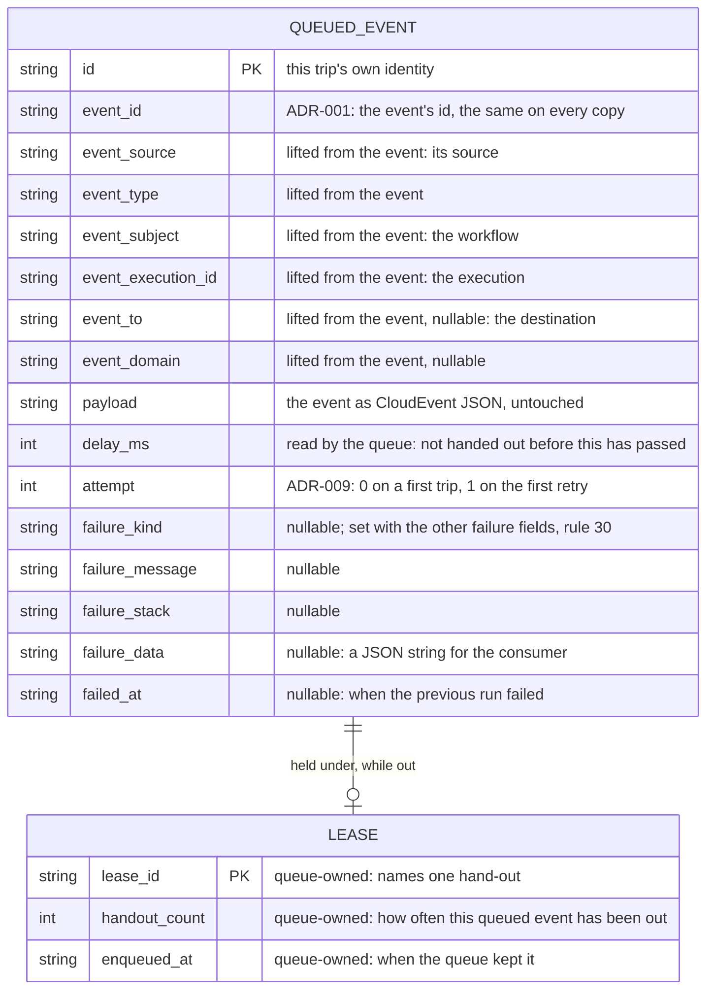
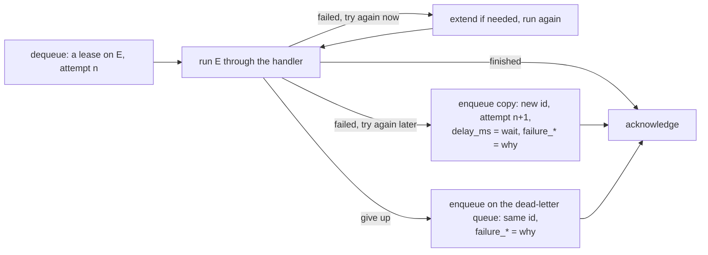
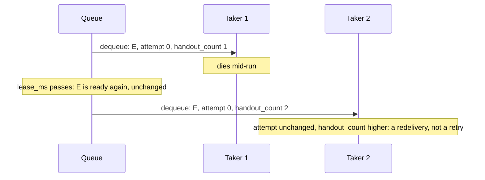

# ADR-021: The Queue

- **Status:** Proposed
- **Date:** 2026-11-02
- **Scope:** Arvo ecosystem
- **Amends:** [ADR-006](./006-arvoeventhandler-protocol.md), **Required of infrastructure adapters** — one additive paragraph: a mechanism MAY carry events between deliveries through a queue as defined here, and where it does, the queue meets [ADR-019](./019-outbox.md) rule 16's demand on its behalf. Additive: nothing already there is replaced
- **Depends on:** [ADR-019](./019-outbox.md), whose rule 16 demands something of a queue without naming one, and whose payload is what a queue carries; [ADR-003](./003-arvoevent-cloudevent-transformation.md), whose CloudEvent form that payload is in; [ADR-001](./001-arvoevent-structure.md), which makes an event's `id` unique everywhere; [ADR-009](./009-execution-bounds.md), which fixes that every delivery carries its attempt number, counted from zero, and that the wait before a retry is the mechanism's to apply; [ADR-008](./008-execution-faults-and-abandonment.md), whose fault carries the kind and the retry permission a mechanism reads when it decides to send an event back; [ADR-010](./010-delivery-classification-and-entry-validation.md), whose gate makes a repeated delivery safe to discard, which is what lets a queue deliver more than once; [ADR-014](./014-idempotency-keys.md), for the same reason on the application's side; [ADR-015](./015-no-ordering-guarantee.md), which forbids any party from promising order; [ADR-004](./004-multi-language-implementation-governance.md), which leaves API shape to each language
- **Addresses, in part:** [ADR-000](./000-arvo-system-identity-and-architectural-principles.md) Deferred Decisions — "Infrastructure adapter interfaces and conformance", the transport adapter; [ADR-019](./019-outbox.md) **Left deferred** — "where events wait", the first of its three parts. Who moves them stays deferred
- **Left deferred:** the party on Arvo's side that calls a queue; who moves events into and out of a queue; every retry policy; what the handler is told from a queued event; what is done with a `too_large` event; a crash loop; what an operator watches; conformance tests. See **Left deferred**

Conformance language is as defined in [ADR-000](./000-arvo-system-identity-and-architectural-principles.md).

## Terminology

- **Mechanism** — as in ADR-006: whatever runs a handler, and everything that happens between one delivery and the next. It is the only party, besides the queue, this ADR speaks of. What it is made of is not defined by any ADR yet, and this one assumes nothing about it beyond what ADR-006 and ADR-019 already require.
- **Queued event** — one event on one trip through a queue: the event's bytes, plus what that trip knows about itself. The same event may be on a queue as more than one queued event at once.
- **Copy** — a queued event made from an existing one, for a retry. It carries the same event and a new identity.
- **Replay** — a copy made from a dead letter onto a working queue, so the event is tried again.
- **Lease** — the queue's promise that, from the moment it handed a queued event to one taker, no other taker is given it until a stated time passes or the taker ends it.
- **Taker** — whoever holds a lease: the caller a `dequeue` handed a queued event to.
- **Dead-letter queue** — a queue, conforming to this ADR, that a mechanism moves a queued event to when it will not run it again.

## Scope

### What this ADR defines

The **queue**: the second durable piece Arvo offers, beside the outbox, so that a mechanism need not build its own. Where an event waits between being committed and being delivered. What a queued event carries, and which of it the queue may read. The operations a queue offers, what each must do, and what each may refuse, including how it says how much room it has. What a lease is, and the rules that make it safe. How a retry is carried, as a copy, and how a dead letter is carried, as a move. And the one promise that makes it a queue rather than a buffer: **a queued event the queue has said it kept is handed out at least once, hidden from everyone else while one taker holds it, and gone for good once that taker says it is finished.**

This ADR is written so that someone who has never read another Arvo record can implement a queue on their own technology and get it right.

### What this ADR deliberately does not define

- **API shape.** Method names, how operations take their arguments, how failure is reported. Each language's own choice ([ADR-004](./004-multi-language-implementation-governance.md)). The names used here are the model's and illustrative.
- **How Arvo calls a queue.** The party on Arvo's side that turns an event into a queued event, checks what a queue returns, and turns its failures into Arvo's own is a later ADR, shaped as [ADR-020](./020-outbox-driver.md) is for the outbox.
- **Who moves events.** What puts events on a queue and what takes them off are the mechanism's, as ADR-006 and ADR-019 leave them, and no ADR has yet given either a shape. This ADR says what the thing they move events through must do, and assumes nothing about them.
- **Policy.** How long a lease is, how long to wait before a retry, how many attempts an event gets, which failures are retried and which are not. The mechanism's, written against this ADR's operations, for a later ADR.
- **How a queue is built.** This ADR names no broker, no table and no technique. Every rule is a behaviour an implementation can be tested against.

### How this ADR changes

Once accepted, this ADR changes only by a superseding ADR. It is not amended in place.

## Context

### A demand with nothing to make it of

ADR-019 marks an event seen only once "a queue has it", and rule 16 says what that means: the queue must keep what it accepts, and nothing may mark an event seen on behalf of one that can lose it. That is a demand on a queue. ADR-019 names no queue to make it of, deliberately, as ADR-006 named no store.

The result is the same as it was for storage before ADR-019: every mechanism writes its own. Each one decides what travels beside the event, how a taker is kept from colliding with another, how a retry is told apart from a redelivery after a crash, and where an event goes when it will not be run again. Each can get any of these subtly wrong in a way only its own tests would catch, and two mechanisms in two languages would not agree on any of it.

### What a mechanism needs from a queue

Ask whether there is room, and whether each event fits, before sending. Put events in, and know for each one whether it is now safe. Take events out, knowing how many times each has been out before. Say an event is finished. Have an event come back when its taker did not finish it. Nothing else touches the queue: deciding whether to retry, how long to wait, and when to give up reads the queue's answers and writes nothing of its own.

That is a small, fixed surface, and it is the same under every broker and every database that can act as one. Naming it lets a queue adapter be written once per technology rather than once per mechanism, and lets Arvo check it once.

### The rules come from the model, not from any product

Every rule below is derived from a guarantee an earlier ADR already makes: an event marked seen is safe (ADR-019), a repeated delivery is harmless (ADR-010, ADR-014), order is never promised (ADR-015), every delivery carries a true attempt number (ADR-009). A technology that cannot meet a rule is not an Arvo queue, in exactly the sense ADR-006 gives for a store that cannot compare-and-swap: "cannot claim conformance at all". The rules are not relaxed to admit a product, and an adapter that has to work to meet one pays that cost itself.

### Why this is a model-level decision

ADR-004 says a decision that is "really a new model-level behavioral commitment" belongs in an ADR. What a queue must guarantee, that kept means safe, that a lease hides, that a retry is a copy and a crash is a redelivery, is such a commitment: a queued event put on a queue by a mechanism in one language must be taken and understood by a mechanism in another. The data model and the rules are the commitment. The method names are not.

## Decision

### A queue holds queued events

**A queue holds queued events: each an event's bytes, exactly as given, together with the event's addressing lifted out beside them and what this trip through the queue knows about itself.** The queue acts on two of a queued event's fields, may place by others, and stores every one of them untouched.



#### The queued event

| Field | From | Role |
|---|---|---|
| `id` | the caller | **key**. Names this trip. A retry copy carries a new one; a move to another queue keeps its own (rules 28 and 29). The one field a queue MAY deduplicate on (rule 5) |
| `event_id` | the event | the event's `id`, unique everywhere under ADR-001, the same on every copy. For finding every trip of one event without opening the payload |
| `event_source`, `event_type`, `event_subject`, `event_execution_id`, `event_to`, `event_domain` | the event | the event's addressing, lifted out. For a queue to place by, where its technology places, and for whoever reads the queue to filter by, without a payload being opened. `event_to` is the destination, as ADR-001 makes it; nothing else names one |
| `payload` | the event | the event as a CloudEvent per ADR-003, written as JSON, byte for byte as given. Nothing a queue needs is inside it |
| `delay_ms` | the caller | **read by the queue**: how long after being kept the queued event may first be handed out, on the queue's clock (rule 8). `0` on a first trip; the wait before a retry on a copy |
| `attempt` | the caller | which attempt the next run of this queued event is, counting from zero as ADR-009 does. `0` on a first trip, `1` on the first copy. The queue never uses it |
| `failure_kind`, `failure_message`, `failure_stack`, `failure_data`, `failed_at` | the caller | why the previous run of this event did not finish, for whoever reads the queue. All five are null on a first trip and set on a copy or a move (rule 30). `failure_kind` is informational: **nothing MAY decide anything from it**. `failure_data` is a JSON string whose content is the caller's. The queue never uses any of them |

**A queue SHOULD NOT have to read anything off the payload.** Every value it needs arrives as a field beside it, and a queue that finds itself opening the payload has found a field this record is missing. `id` and `delay_ms` are the two it acts on under the rules below. The `event_*` fields are there so that a queue whose technology places queued events, by destination, by workflow, by execution, has what it needs to do so; whether it does, and by which, is its own. Every field is stored and handed back exactly as given, so that what a mechanism in one language wrote, a mechanism in another reads unchanged.

#### Where the fields come from

**The party that builds a queued event supplies every field.** The `event_*` fields are the event's own values, lifted out so that the queue and whoever reads it need never open the payload; they MUST agree with the payload, and keeping them so is the builder's, not the queue's. Where the builder reads them from is its own business and a later ADR's. The queue receives a complete record and asks nothing about its origin.

#### Field domains

What each field may hold, so that two implementations agree before a value crosses between them. ADR-002's constraints on an event's own fields carry over to the `event_*` fields, which hold those same values.

| Field | Domain |
|---|---|
| `id`, `event_id`, `event_source`, `event_type`, `event_subject`, `event_execution_id` | non-empty string; no control characters or unpaired surrogates, as ADR-002 constrains every string field of an event |
| `event_to`, `event_domain` | the same, or null |
| `payload` | a string holding a JSON document |
| `delay_ms` | an integer, zero or more |
| `attempt` | an integer, zero or more |
| `failure_kind`, `failure_message`, `failure_stack` | a string as above, or null |
| `failure_data` | a string holding a JSON document, or null |
| `failed_at`, `enqueued_at` | RFC 3339 with an offset, as ADR-001 fixes `time`; `failed_at` nullable |
| `lease_id` | non-empty string, not guessable (rule 13) |
| `handout_count` | an integer, one or more |
| `at_most` | an integer, one or more |
| `capacity`'s `events[].id` | a non-empty string, as `id` |
| `capacity`'s `events[].bytes` | an integer, zero or more: the payload's size |
| `held`, `size`, `limit`, `limit_bytes`, `oldest_ready_age_ms` | an integer, zero or more |
| `too_large` ids | ids from the asked-for list, each at most once |
| `lease_ms` | an integer, one or more, and at most the queue's lease ceiling (rule 16) |

#### What the payload is

**The payload MUST be the event in CloudEvent form, as ADR-003 defines the transformation, written as a JSON string.** ADR-003 fixes CloudEvents as the form an event takes outside Arvo, and a queue is outside Arvo, so what goes on is what comes off: whoever enqueues puts the bytes on, and whoever dequeues takes the same bytes off. Nothing about a trip is written into the payload: a copy for a retry carries the same bytes as the trip before it. What a queued event knows about its trip lives beside the payload, never inside it.

#### The lease

Three fields are the queue's own and travel with every hand-out:

| Field | Role |
|---|---|
| `lease_id` | names this one hand-out. A plain string any caller may present, from any process, until the lease ends (rule 13) |
| `handout_count` | how many times the queue has handed this queued event out, this hand-out included: `1` the first time. Kept by the queue across every taker, every process and its own crash (rule 9). This is how a taker tells a redelivery after a crash from a retry a mechanism made on purpose (**How the operations compose**) |
| `enqueued_at` | when the queue kept this queued event, by the queue's own clock, so anyone can see how long it has been travelling |

### Five operations

```
enqueue(queued_events)                 → per queued event: kept | refused(reason)
dequeue(at_most, lease_ms)             → leases, each with its queued event
extend(lease_ids, lease_ms)            → per lease: kept | lease_lost
acknowledge(lease_ids)                 → per lease: kept | lease_lost
capacity(events)                       → room for those: a status, and the kinds behind it
```

**A queue MUST offer every one of these, with these behaviours, and SHOULD offer nothing that reaches a delivery.** A queue MAY be asked read-only questions beyond these, about what it holds: how many queued events are ready, leased and delayed, say, or a look at what is ready without leasing it, for whoever reads a dead-letter queue.

**An implementer's operations are plain.** They return values and they may throw whatever their technology throws. A queue MUST NOT be required to produce Arvo's faults, results or errors; turning its answers and failures into those is the caller's, as [ADR-020](./020-outbox-driver.md) does for the outbox and a later ADR will do here.

### Keeping

1. **Kept means safe.** `enqueue` MUST answer `kept` for a queued event only once it would survive the queue's own crash. Not accepted, not buffered: durable, in whatever sense the technology has one. This is what ADR-019 rule 16 demands, met, and it is the one rule a conformance suite cannot check (**Left deferred**).
2. **Every outcome is per queued event.** One `enqueue` may keep some and refuse others. The answer MUST carry one outcome for every `id` given, none missing.
3. **A refusal is an answer, not a failure.** A queued event too large for the queue, or a queue with no room, is ordinary, and the queue MUST report either as a value: `too_large` or `no_room`. The queue MUST throw only where it could not do its work at all. Where `enqueue` throws, the caller learns nothing about which queued events were kept, and the right response is to enqueue the same batch again with the same `id`s; that is why `id` is the caller's to choose, and what rule 5 is for.
4. **Every field comes back as it went in.** A queued event MUST be stored as given and handed back as given, `payload` included. The queue MUST NOT alter, add to or drop any field. Which fields it reads for its own placement is its own business, and no placement excuses it from any rule here: a queued event placed anywhere is still kept, still handed out at least once, still hidden under its lease.
5. **A queue MAY deduplicate, by `id` only, and only against what it still holds.** A queue MAY treat a queued event whose `id` it currently holds, not yet acknowledged, as already kept: write nothing for it, answer `kept`, and do not fail. It MUST NOT remember an acknowledged `id` for this purpose: an `id` enqueued again after its queued event was acknowledged is a new queued event, kept and handed out like any other. It MUST NOT deduplicate on `event_id` or anything else: the same event is legitimately on a queue more than once (rule 28). Nothing above the queue may rely on a queue deduplicating at all.

### Handing out

6. **Every kept queued event is handed out at least once, within finite time.** Twice is permitted; never is not, and neither is a ready queued event left waiting for ever behind newer ones. How soon beyond that, and how fairly, is the implementer's. A receiver discards a repeat at the gate ([ADR-010](./010-delivery-classification-and-entry-validation.md), step 9), so correctness never depends on handing out once.
7. **Order is never promised.** A queue hands queued events out in whatever order suits it. Nothing downstream may rely on any order ([ADR-015](./015-no-ordering-guarantee.md)).
8. **The delay is kept.** A queued event MUST NOT be handed out until `delay_ms` has passed since the queue kept it, measured on the queue's own clock. `delay_ms` is the only clock-bearing value a caller gives a queue, and it is a duration so that only one clock is ever involved.
9. **Every hand-out is counted.** `handout_count` MUST be `1` the first time a queued event is handed out and one higher each time after, counting every taker in every process, and surviving the queue's own crash.
10. **Up to `at_most`, never more.** `dequeue` MAY return fewer, including none.

### Leases

11. **A leased queued event is hidden.** From the moment `dequeue` hands a queued event out until its lease ends, a `dequeue` MUST NOT return it to anyone.
12. **A lease ends two ways.** `lease_ms` passes since it was granted or last extended, on the queue's clock as `delay_ms` is; or it is acknowledged. A refused extension (rule 16) ends nothing: the lease runs to the expiry it already had and simply gets no more. A lease that ends without being acknowledged makes its queued event ready again at once, with the same fields it had; `delay_ms` counts from when the queued event was kept, never from when a lease ended.
13. **A lease id is a plain string anyone may present.** `extend` and `acknowledge` MUST accept a lease id from any caller, in any process, as long as the lease is live. A queue MUST NOT bind a lease to a connection, a session or the process that took it. Because holding the string is holding the lease, a lease id MUST NOT be guessable: not a counter, not the queued event's `id`.
14. **A queue MUST NOT lie about a lease.** Where `extend` or `acknowledge` is asked about a lease that has already ended, however it ended, the queue MUST answer `lease_lost` for it, and MUST NOT answer `kept`, because the queued event may already be in another taker's hands. It MUST NOT throw for it: it could do its work, and the answer is no. Every outcome is per lease, as rule 2 is per queued event. A taker that is told `lease_lost` does nothing further for that queued event: if the lease ran out, the queue has already made the event ready again (rule 12); if it was acknowledged, the event is finished. Either way there is nothing left for the taker to do, and making a copy would only add a repeat.
15. **Acknowledged is gone.** A queued event whose lease is acknowledged MUST never be handed out again, whatever happens afterwards.
16. **Leases have a ceiling.** A queue MUST hold, in its own options, a longest total time one lease may run, and MUST refuse an extension that would take the lease past it, as `lease_lost`. The refusal grants nothing and takes nothing: the lease keeps the expiry it had (rule 12). A `dequeue` or `extend` asking a `lease_ms` above the ceiling on its own is the caller's error and MUST throw; a queue MUST NOT grant a shorter lease than it was asked for, so a taker always knows how long it holds. The value is the deployment's; that there is one, and that it is kept, is the rule, so that a taker that is alive but stuck cannot hide a queued event for ever.

### Capacity

A queue feels pressure at two ends and per event: no room to keep more, at the in end, on a bounded queue; takers not keeping up, at the out end, on every queue; and a payload too big to keep at all. Events that cannot be queued stay in the outbox unseen and are tried again, so a caller that cannot ask first hammers a full queue at exactly the moment it is struggling. `capacity` is the one question that answers all three, asked with the events the caller means to enqueue: each one's `id` and its payload's size in bytes, and nothing else.

17. **`capacity` MUST answer a status for the asked-for events, and MAY answer the kinds and numbers behind it.** The status is one of `available`, `tolerating` or `exhausted`. Behind it the queue MAY give up to three kinds, each with its own status in the same three words:
    - `room` — whether it can keep that many more. It MAY give how many it would then hold, what it is meant to hold (past this, `tolerating`) and the most it should ever hold (past this, `exhausted`).
    - `payload` — whether each payload can be kept at all. `exhausted` here never clears. It MAY give the limit in bytes where the limit is one number, and MUST give the ids whose payload cannot be kept where it answers other than `available`.
    - `backlog` — how far behind the takers are, by the age of the oldest ready queued event. It MAY give that age.

    A queue that limits nothing and measures nothing answers `available` with no kinds, and pays nothing for this operation.
18. **The status is the worst of the kinds.** `exhausted` before `tolerating` before `available`; `available` where there are no kinds. A caller that reads one word is safe: `available` means send, anything else means look inside or do not.
19. **Asking changes nothing.** The answer describes the queue as it would be with the asked-for events added, not as it is made to be. It MAY be an estimate.
20. **Everything held counts.** Ready, leased and delayed queued events all take room; acknowledged ones count for nothing. A queue that deduplicates (rule 5) MAY leave out ids it already holds.
21. **An answer MAY hold steady.** A queue that has answered `tolerating` for a kind MAY keep doing so until that kind has eased well below where it began, so that one event in or out does not flip the answer.
22. **An answer can be overtaken.** Other callers land between asking and enqueueing, and an estimate can be off. Nothing held is lost or altered by this. **A queue whose limit must never be passed MUST refuse inside `enqueue`**, with `no_room` or `too_large`, because `capacity` alone cannot hold a line.
23. **Whether `enqueue` enforces it is the implementer's.** A queue MAY refuse at `enqueue` what it would answer `exhausted` for, and need not. `capacity` states the queue's room; it does not oblige the queue to defend it.
24. **`payload` at `available` is a promise.** An id the `payload` kind did not name will not be refused as `too_large` by the `enqueue` that follows, so a caller can set aside the named ones and send the rest. Nothing else in the answer is a promise: `room` at `available` can still meet `no_room`, and a queue that gave no `payload` kind may still refuse a payload.
25. **`backlog` describes the takers, not the queue.** It is given so that a caller can ease off a queue whose takers are behind. The queue is asked to do nothing about it, and this ADR says nothing about how old is too old.
26. **Nothing here is policy.** What a caller does with `tolerating`, with `exhausted` of any kind, or with an old backlog is the mechanism's, and deferred.

### Lifecycle

27. **Nothing works before open or after close.** Where a queue has an open and a close, every other operation MUST throw outside them. Leases already granted keep their timers and end on their own; a caller closing its handle on the queue does not end the leases it holds.

### Copies and moves

28. **A retry is a copy with a new `id`.** A mechanism that will run a queued event again later makes a new queued event: the same `payload`, `attempt` one higher, the failure fields set, `delay_ms` as its wait, and a **new `id`**. It enqueues the copy and then acknowledges the lease it holds, in that order, so that a crash between the two leaves a duplicate and never a loss. The queue sees two unrelated queued events, and rule 5 is why it must.
29. **A move keeps its `id`.** A mechanism that takes a queued event off one queue and puts it on another, as to a dead-letter queue, enqueues it there **with the same `id`** and `attempt` unchanged, and then acknowledges the lease it holds. If it crashes between the two, the queued event comes back and is moved again, and the receiving queue MAY recognise the repeat under rule 5. The receiving queue's `handout_count` starts again, because it is that queue's own; a mechanism that wants the count it left behind kept writes it into `failure_data`. A replay, from a dead-letter queue back to a working one, is a copy under rule 28 and not a move: it carries a new `id`, so that rule 5 on the working queue can never swallow it. `too_large` is final for a copy: the same bytes will be refused again, so a mechanism MUST NOT answer it with a retry.
30. **The failure fields travel together.** On a first trip all five are null. On a copy, and on a move, the caller MUST set `failure_kind`, `failure_message` and `failed_at`, MAY set `failure_stack` and `failure_data`, and MUST NOT set any of the five while `failure_kind` is null.

### How the operations compose

Illustrative, not normative. The rules above exist to keep this working, and it is the part of a queue that is easy to get wrong without seeing it whole. None of what follows is the queue's to do, and none of it is required of a mechanism by this ADR; it shows what the operations are for, in terms of a mechanism that uses them.



- **Again now.** Some failures are worth one more try at once: the outbox refused a commit as `revision_stale`, so re-read and run again. The taker keeps its lease, extends it if the tries run long (rule 16 bounds how long), and acknowledges when done.
- **Again later.** The mechanism makes a copy (rule 28). `attempt` goes up by one, `delay_ms` carries the wait it chose, and the failure fields say why. How long the wait is, and when the attempts are spent, is read off the fault ADR-008 and ADR-009 define, and applying it is the mechanism's.
- **Give up.** The mechanism moves the queued event (rule 29) to a dead-letter queue, which is a queue under this ADR and nothing more, with the failure fields set so that whoever reads it knows why without finding the outbox record. Some dead letters never had a record: an event nobody handles, or a payload that will not parse. The failure fields are how those are explained.

  **A dead-letter queue is built from the same queued event and the same five operations.** It needs no field this ADR does not already define: the `event_*` fields say what and whose the event is, `attempt` says how far it got, the failure fields say why it stopped, and `payload` is the event itself, ready to be replayed as a copy on the working queue (rule 29). An implementation that offers one queue offers a dead-letter queue by making a second one.

#### A crash is not a retry



Where a taker dies, nobody makes a copy, so `attempt` does not move. The queued event comes back exactly as it was, with `handout_count` one higher (rule 9). That difference is a mechanism's only way to tell "this came back because its taker died" from "I sent this back on purpose", and what it does with it is policy (**Left deferred**). Without rule 9, a queued event whose every run crashed the taker would sit at `attempt` 0 for ever and never meet ADR-009's bound.

### What a queue is not

- **Not the outbox.** It keeps nothing about an execution and answers nothing about what was committed. ADR-019 **Considered Alternatives** already rejects one piece doing both.
- **Not a router.** It delivers to whoever dequeues; it sends nothing anywhere itself. Where it holds a queued event internally, and whether `event_to` or any other lifted field decides that, is its own business, and nothing Arvo defines depends on the answer.
- **Not a judge.** It MUST NOT decide whether to retry, how long to wait, or when to give up. It stores `attempt`, `delay_ms` and the failure fields for whoever does.
- **Not a parser.** It should never need to open the payload: every value it could want is a field beside it.

## Consequences

### Gained

- ADR-019 rule 16 has something to make its demand of: a queue is defined, and "a queue has it" means `kept` under rule 1.
- A queued event put on a queue by a mechanism in one language is taken and understood by a mechanism in another: the fields, their meanings, and the copy-versus-move rule are the same everywhere. This is the property ADR-004 exists to secure.
- An implementer who knows their technology and nothing of Arvo can write a conforming queue from this record alone: two fields to read, everything else stored, plain operations, values returned, failures thrown.
- A retry and a redelivery after a crash are told apart by two numbers the model owns, so ADR-009's attempt bound can be enforced on either.
- Two mechanisms can share one queue, and an application can change mechanism without its handlers noticing.
- Dead letters need no second design. They are a second queue, and the failure fields make them readable.
- A caller can ask before it sends, in one question, whether there is room, whether each payload fits, and whether the takers are keeping up, and a queue that limits nothing answers in one word.

### Paid for

- **One more component every implementation must write and test.** Accepted because it replaces the same component written per mechanism.
- **A queued event carries fields many queues will never read:** the six `event_*` fields and the five failure fields. Accepted because they are for the queues that place, and for the people and tools reading any queue, cost a few values per trip, and keep the payload closed.
- **A queue that places by execution or subject will tempt a mechanism to rely on the order that falls out.** Accepted because ADR-015 already forbids it, and nothing here weakens that: placement is the queue's convenience, never a promise.
- **The failure fields can disagree with the outbox record,** since a mechanism writes them after the fact. Accepted because nothing may decide from them; they explain, and the record decides.
- **Every queue must count hand-outs durably and offer `extend`,** which some technologies do not do natively. Accepted because both come from the model: without the count a crash loop never ends, and without `extend` an honest long run must give up its lease. An adapter that has to build either pays for it, as a store that has to build compare-and-swap does under ADR-006.
- **A lost lease is not detected until the taker speaks.** Two takers can run one queued event for a while before `lease_lost` tells the first. Accepted because ADR-010's gate and the outbox's compare-and-swap make the second run harmless, and rule 14 makes sure the first taker learns the truth.
- **A duplicate is possible at every step,** by design: enqueue before acknowledge on both copies and moves. Accepted because a loss is not possible at any step, and ADR-014 makes a duplicate harmless.
- **Copies can multiply.** A crash between enqueuing a copy and acknowledging the original leaves both live, and a second crash can do it again. Accepted because each is a harmless repeat under ADR-010, and because ADR-009's attempt bound, applied by the mechanism, ends every line of copies; a loss would be worse than any number of repeats.

## Considered Alternatives

### The outbox as the queue

Considered and rejected by ADR-019 already: it makes every outbox a queue, which most databases are poor at, and a deployment with a real queue would have two. This ADR gives the queue its own shape instead.

### Trip fields as CloudEvents extension attributes

Considered: writing `attempt`, `delay_ms` and the failure fields into the event itself, as `arvoattempt` and so on, so that one CloudEvent carries everything and tooling that knows CloudEvents can read the attempt. Rejected on four counts. Every copy would carry different bytes, so what is on the queue would no longer be what the outbox committed, and ADR-019's recovery, which resends committed bytes, would no longer describe what travels. Trip facts would leak into the event a handler sees, where ADR-009 deliberately gives `attempt` through the execution context and not the event. ADR-001 and ADR-003 would both have to be superseded, and ADR-003's strict reverse rejects unexpected content today. And every copy of every event would carry a stack trace inside it. The one gain, legibility to CloudEvents tooling, is had without the cost: a queue adapter that speaks CloudEvents natively MAY carry the queued event's fields as transport metadata beside an untouched payload, which is what CloudEvents' binary content mode is for.

### The queue counting attempts

Considered: `attempt` as the queue's own field, raised on every hand-out, so a mechanism need not make copies. Rejected because every technology counts hand-outs differently and some count none, so the number would mean something different on every queue; because a retry that must wait would need a separate operation to put a queued event back with a delay; and because the count would no longer tell a crash from a deliberate retry. `handout_count` keeps the queue's count beside Arvo's, and the two together say more than either alone.

### A release operation

Considered: an operation to give a leased queued event back, optionally after a wait, instead of making a copy. Rejected because it puts the retry's facts, the new attempt number and the reason, nowhere: the queued event comes back as it went out, so the mechanism must remember them somewhere else or lose them. A copy carries them durably, on the queue, with everything else.

### One identity for every copy

Considered: the event's `id` as the queued event's only identity. Rejected because the same event is legitimately on a queue more than once: a copy for a retry beside the original that a crash brought back, or a dead letter beside a copy still being tried. With one identity a deduplicating queue would drop one of them, and it might be the retry. Two identities do two jobs: `event_id` says which event, `id` says which trip.

### A fixed vocabulary for `failure_kind`

Considered: `failure_kind` drawn from ADR-008's fault kinds and the outbox driver's error kinds only. Rejected because a mechanism meets failures neither vocabulary names, an event nobody handles or a payload that will not parse among them, and a fixed list would grow by amendment every time one was met. Since nothing may decide from the field, a free string costs nothing in correctness and the rule that nothing routes on it does the work the type would have done.

### The delay as a point in time

Considered: a `not_before` timestamp instead of `delay_ms`. Rejected because it names no clock: written by the caller and read by the queue, on two machines, it is early or late by the difference between them. A duration involves one clock, the queue's, from the moment it kept the queued event.

### `extend` as optional

Considered: letting a queue that cannot extend a lease leave the operation out, so more technologies fit. Rejected because the model needs it: a taker that tries again in place, which ADR-019's `revision_stale` invites, must be able to keep its lease honestly or give up its work, and because declaring which operations a queue supports is the capability profile ADR-000 defers, which this ADR will not settle by the back door. A technology that cannot extend a lease builds it or is not an Arvo queue.

### Capacity asked with a count

Considered: `capacity` asked with how many events, as the outbox is, and the size of the largest. Rejected because it pre-digests the batch on the queue's behalf and so assumes which totals the queue limits on: some limit the count, some the largest payload, some the bytes of a batch or of everything held. Given one entry per event, each with its `id` and size, the queue works out whichever sums it needs, and can name the ids that will not fit. The cost is a short string and a number per event, and the queue still opens nothing.

### One status word for every kind of pressure

Considered: a single status whose values include `too_large`, instead of kinds each with a status. Rejected because room and size are different problems with different answers: no room clears with time, too large never does, and a caller splitting a batch needs both answers at once. One word can hold only one of them. The kinds keep one vocabulary, and the summary stays the worst of them, so a caller that reads one word is still told the truth.

### A pile count instead of capacity

Considered: an operation answering how many queued events are ready, leased and delayed. Rejected as a required operation because no rule of the model depends on it, and it asks every queue to count exactly where some cannot cheaply. A queue MAY answer it as a read-only question; what an operator watches is deferred.

### Deduplication required

Considered: every queue dropping a repeated `id`. Rejected because it would make rule 29's idempotent move depend on the queue, where ADR-010's gate already makes the repeat harmless, and because it asks every technology for an index it may not have for a guarantee nothing needs. Permitted, never relied on.

### No failure fields

Considered: a queued event carrying only `id`, `event_id`, `payload`, `delay_ms` and `attempt`. Rejected because a dead-letter queue without a reason is unworkable to operate, and because some dead letters never produced an outbox record to carry the reason instead. The fields are nullable and null on every first trip, so a queue that never sees a retry pays nothing for them.

## Conformance to ADR-000

### Effect on AAM

None to the membership list. The queue is an infrastructure adapter under ADR-000's own term, "an integration binding the model to … transport", and this ADR gives one such adapter its interface, which ADR-000 defers under "Infrastructure adapter interfaces and conformance". The event it carries is ADR-003's, unchanged, and the payload is ADR-019's, unchanged.

### Invariants depended on

- **Infrastructure Independence.** This ADR names no broker and requires none. Every rule is a behaviour.
- **Explicit Contracts and Runtime Validation.** What a queue returns will be checked before Arvo trusts it, by the party a later ADR defines; nothing is trusted because of where it was queued.
- **Event-Only Communication.** A queue adds no control path. It carries events and answers questions about them.

### Invariants strained

- **Infrastructure Independence,** mildly: a queue must count hand-outs durably and extend a lease. Both are behaviours the model requires, not technologies it names, and an adapter builds what its technology lacks, as ADR-006 already asks of a store that cannot compare-and-swap.

### Required of infrastructure adapters

One thing added to ADR-006 **Required of infrastructure adapters**, additively: **a mechanism MAY carry events between deliveries through a queue conforming to this ADR**, and where it does, the queue meets ADR-019 rule 16's demand on its behalf: an event marked seen after the queue answered `kept` is safe. The publishing half of ADR-006 obligation 1 remains the mechanism's, met where it enqueues what the outbox holds unseen and dequeues to deliver; obligation 4, that every retry is a fresh delivery, is met because every run, whether again in place under a lease or from a copy under rule 28, enters the handler afresh with nothing carried from the run before. A mechanism MUST NOT mark an event seen on an answer other than `kept`.

### Left deferred

- **The party on Arvo's side that calls a queue.** What turns an event into a queued event and back, checks every answer, and turns a queue's failures into Arvo's own. The next ADR, shaped as [ADR-020](./020-outbox-driver.md) is for the outbox.
- **Who moves events.** What takes events from the outbox to a queue, and from a queue through a handler. The mechanism's, as ADR-006 and ADR-019 leave them, for a later ADR.
- **What is done with a `too_large` event.** `capacity` lets a caller see one before sending (rule 24), and rule 29 says it is never retried. Where it goes instead, and whether a dead-letter queue takes a larger size than the working queue, is policy, and a mechanism MUST have an answer before it claims conformance.
- **A crash loop.** A redelivery after a crash never raises `attempt` (**A crash is not a retry**), so a queued event whose every run kills its taker would loop for ever unless the mechanism reads `handout_count` and acts. What it does is policy, deferred below; that it MUST do something is not, and no mechanism may claim conformance to this ADR's use until a later ADR says what.
- **Policy.** The lease length, the wait before each retry, the attempt bound's value, which failures are tried again now, which later and which never, whether a replay from a dead-letter queue resets `attempt`, and what a mechanism does when `handout_count` says a queued event keeps coming back without a copy being made. All for a later ADR, read where ADR-008 and ADR-009 already put the figures.
- **What the handler is told.** ADR-009 has the mechanism supply `attempt`. That it is the queued event's `attempt` is the natural reading, and a later ADR will say so or say otherwise.
- **What an operator watches.** `capacity` makes one number available, the age of the oldest ready queued event, which shows when nothing is dequeuing. Which numbers a queue must publish, and how, is for a later ADR.
- **The lease ceiling's default.** Rule 16 requires one; its name and default value are each implementation's, for now.
- **Whether a handler's produced events may go straight onto a queue** by whatever ran it, rather than only from the outbox's unseen list. Faster, and a second path for events to travel. Open.
- **Conformance tests for a queue.** A suite every queue implementation runs, as ADR-004 asks of every protocol piece, one check per rule above except rule 1, each proved by a queue broken in exactly that way. Rule 1 is a durability promise that only a crash test can show, and the suite MUST say so rather than claim it.

## Appendix: An illustrative surface

Not normative. One way the operations could look, in no particular language. `QueuedEvent` is the queued event of **The queued event**, with every field it lists.

```
interface Queue
  enqueue(queued_events: list of QueuedEvent):
    list of { id: string, outcome: 'kept' }
          | { id: string, outcome: 'refused', reason: 'too_large' | 'no_room' }

  dequeue(at_most: integer, lease_ms: integer):
    list of { lease_id: string, queued_event: QueuedEvent, handout_count: integer, enqueued_at: timestamp }

  extend(lease_ids: list of string, lease_ms: integer):
    list of { lease_id: string, outcome: 'kept' | 'lease_lost' }

  acknowledge(lease_ids: list of string):
    list of { lease_id: string, outcome: 'kept' | 'lease_lost' }

  capacity(events: list of { id: string, bytes: integer }): {
    status: 'available' | 'tolerating' | 'exhausted',          the worst of the kinds
    kinds: {
      room?:    { status, held?: integer, size?: integer, limit?: integer },
      payload?: { status, limit_bytes?: integer, too_large?: list of string },
      backlog?: { status, oldest_ready_age_ms?: integer }
    }
  }
    held                — how many it would hold with the asked-for events added
    size                — what it is meant to hold; past this, tolerating
    limit               — the most it should ever hold; past this, exhausted
    too_large           — the ids whose payload cannot be kept
    oldest_ready_age_ms — how long the oldest ready queued event has waited

  open(): nothing          optional
  close(): nothing         optional
```
