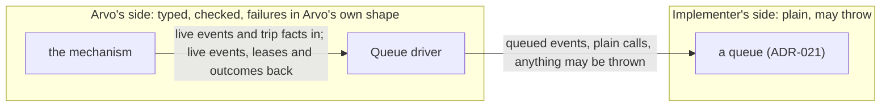
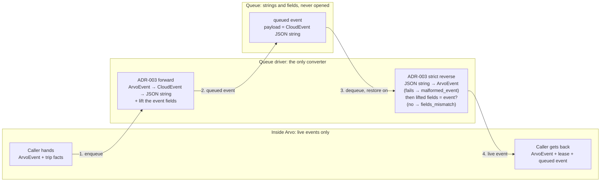

# ADR-022: The Queue Driver

- **Status:** Accepted
- **Date:** 2026-11-04
- **Scope:** Arvo ecosystem
- **Amends:** nothing. Every rule here is new
- **Depends on:** [ADR-021](./021-queue.md), which defines the queue this ADR puts one party in front of, the queued event it carries, and every outcome it answers; [ADR-003](./003-arvoevent-cloudevent-transformation.md), whose transformation this party applies in both directions; [ADR-001](./001-arvoevent-structure.md), whose fields the queued event lifts and the queued event's `id` is derived from; [ADR-002](./002-arvoevent-field-domain-constraints.md), whose string rules make that derivation's delimiter safe; [ADR-006](./006-arvoeventhandler-protocol.md), whose derivation of `execution_id` this ADR's derivation follows; [ADR-020](./020-outbox-driver.md), whose shape this ADR follows for the same reasons, so that a reader who knows one driver knows both; [ADR-018](./018-trace-context-across-layers.md), which fixes how a party that carries an event joins its trace, and so what this party, which carries none onward, is not
- **Addresses, in part:** [ADR-000](./000-arvo-system-identity-and-architectural-principles.md) Deferred Decisions — "Infrastructure adapter interfaces and conformance", how the model side meets a transport adapter; [ADR-021](./021-queue.md) **Left deferred** — "the party on Arvo's side that calls a queue"
- **Left deferred:** what a mechanism does with each outcome and each failure the driver reports; who moves events; the span's name and attributes; conformance tests. See **Left deferred**

Conformance language is as defined in [ADR-000](./000-arvo-system-identity-and-architectural-principles.md).

## Scope

### What this ADR defines

The **queue driver**: the one party on Arvo's side that calls a queue. What it does on the way in — turning live events and what their trip knows into the queued events a queue stores, and deriving each queued event's `id` so that the same send always carries the same name. What it does on the way out — checking everything a queue returns before anything in Arvo trusts it, restoring each payload to a live event, and confirming the fields lifted beside the payload still agree with it. How it reports failure, as one error whose kind says why. How it hands back an outcome a queue answered, kept or refused, lease kept or lost, without turning it into a failure. And what it must never decide.

### What this ADR deliberately does not define

- **API shape.** Whether the driver is a class or a set of functions; what its operations are called; how it reports failure in each language's idiom. Each language's own choice ([ADR-004](./004-multi-language-implementation-governance.md)).
- **The queue.** [ADR-021](./021-queue.md).
- **Who moves events, and when.** What puts events on a queue and what takes them off, how long to lease, whether to try again, when to give up. The mechanism's, as ADR-006 and ADR-021 leave them, and a later ADR's. The driver gives a caller every fact it needs to decide and decides nothing.
- **The driver's span name and attributes.** API shape, as ADR-018 already says of every party.

### How this ADR changes

Once accepted, this ADR changes only by a superseding ADR. It is not amended in place.

## Context

### Two sides that must look different

ADR-021 makes a queue deliberately plain: an implementer returns values and throws whatever their technology throws, stores every field as given, and is never asked to produce Arvo's faults, results or errors. That is what makes a queue writable by someone who knows only their broker or their database.

Arvo's side needs the opposite. ADR-000 requires runtime validation of everything crossing a boundary. A queue hands back strings that must become live events, lifted fields that must still agree with those events, and outcomes whose shape must be exactly what ADR-021 fixes. Something has to stand between the two sides and translate, and if that something is written in every place Arvo touches a queue, it is written many times and differently.

### What ADR-020 already settled, and this ADR reuses

ADR-020 drew this line for the outbox: one party calls it, builds what it stores, checks what it returns, converts in both directions, reports one error with a kind, and decides nothing. Every one of those reasons holds for a queue, and a second driver shaped differently would make a mechanism learn two ways of meeting the same kind of boundary. This ADR therefore follows ADR-020's shape and departs from it only where a queue differs from an outbox: a queue answers per item, so its outcomes are values; a queue carries the event's addressing lifted beside the payload, so there is something to check against; and nothing a queue does happens inside a delivery, so no failure here can become a fault.

### Why this is a model-level decision

Where the boundary between Arvo and a queue sits, what crosses it in each direction, and what a failure on the far side becomes on the near side are commitments every language must share, or a mechanism moving between them would meet different failures from the same queue. The method names are not such a commitment.

## Decision

### One party calls the queue

**Nothing in an implementation holds or calls a queue except its driver.** The driver takes a queue when it is built and is the only thing that invokes the queue's operations. The driver does not itself satisfy the queue interface: the two sides are meant to look different.



### On the way in: the driver builds what the queue stores

**The driver MUST build every queued event the queue receives, and nothing else may.** For each live event a caller hands it, the driver converts the event to a CloudEvent with ADR-003's forward transformation, writes that as a JSON string, and builds the queued event ADR-021 lists with that string as `payload`. **It MUST lift `event_id`, `event_source`, `event_type`, `event_subject`, `event_execution_id`, `event_to` and `event_domain` off the event** and set them beside the payload as plain values, so the queue never opens the payload for anything.

**The caller supplies what the trip knows, and the driver writes it as given.** The caller hands the driver, per event:

- **`attempt`**, counting from zero as ADR-009 does;
- **`delay_ms`**, how long the queue is to hold the queued event back;
- **a failure, or none.** Where there is one, the caller gives its kind, message, stack, details and the time it happened, and the driver sets `failure_kind`, `failure_message`, `failure_stack`, `failure_details` and `failed_at` from it, together, as ADR-021 rule 30 requires. Where there is none, all five are null.

The caller supplies no `id`. The driver derives it (**The queued event's `id`**), and the driver knows nothing of whether a queued event is a first trip, a copy or a move. Those are the caller's words for the numbers it chose to pass, and to the driver every enqueue is the same operation with different values on it.

### The queued event's `id`

**The driver MUST derive each queued event's `id` from the event and the attempt, and from nothing else.** ADR-021 rule 3 has a caller whose `enqueue` threw send the same batch again with the same ids, and rule 5 lets the queue drop the repeats; that works only if the id exists before the queue is called and is the same on every honest re-send. A queue that assigns ids on arrival cannot give that; a random id gives it to no one; a caller minting it would write the rule once per mechanism per language. So the driver derives it, the one place the rule can be written once, and derives it purely.

```
queued_event.id = SHA-256(
    utf8("arvo-queue-v1")         ‖ 0x00 ‖
    utf8(event.id)                ‖ 0x00 ‖
    utf8(event.subject)           ‖ 0x00 ‖
    utf8(event.executionid)       ‖ 0x00 ‖
    utf8(event.parentid  or "")   ‖ 0x00 ‖
    utf8(event.initid    or "")   ‖ 0x00 ‖
    utf8(event.source)            ‖ 0x00 ‖
    utf8(event.type)              ‖ 0x00 ‖
    utf8(event.to        or "")   ‖ 0x00 ‖
    utf8(event.domain    or "")   ‖ 0x00 ‖
    utf8(event.dataschema)        ‖ 0x00 ‖
    utf8(event.time)              ‖ 0x00 ‖
    utf8(decimal(attempt))
  ) rendered as 64 lowercase hexadecimal characters
```

- **Algorithm:** SHA-256, as specified in FIPS 180-4, as ADR-006 chose for `execution_id` and for the same reason: it is in every language's standard library, and nothing here needs more than collision resistance.
- **Input:** the UTF-8 bytes of each part, joined by the single byte `0x00`. ADR-002 forbids that byte inside any string field, so no two distinct inputs produce the same byte string. A null field is written as the empty string, which is safe because every nullable field here is a string ADR-002 makes non-empty where present. `attempt` is written as decimal digits, no sign, no padding. The first part is a fixed tag, so that a later ADR changing this derivation changes the tag and never collides with ids already on a queue.
- **Output:** lowercase hexadecimal, 64 characters, no prefix and no separator.
- **Pure:** no randomness, no clock, no mutable input. The same event at the same attempt derives the same id in every language. An implementation MAY offer the derivation on its own, for tests and tooling.

**Why these fields and no others.** The input is every field of the event that names it and is a plain string: its `id`, its workflow and execution, its causation, its addressing, its contract version and its time. The event's `id` alone is required to be unique by ADR-001 but cannot be enforced on a producer outside Arvo's tooling, so the rest are there so that a reused `id` on a different event still derives a different name. `data` and `baggage` are left out because hashing them would need the canonical JSON ADR-003 defers. `traceparent` and `tracestate` are left out because ADR-018 lets a layer rewrite them between hops, so they differ between two honest re-sends of one event. `depth`, `executionunits` and `category` are left out because they do not name the event. `delay_ms` and the failure fields are left out because they describe the trip, not the event, and two honest re-sends of one attempt may carry different ones.

**What follows for free.** A retry is a copy with a new `id`, because `attempt` went up; a move keeps its `id`, because the event and the attempt did not change; a re-send of a batch that threw repeats every `id` exactly; and two takers that both lost a lease on the same attempt and both send it again produce one `id`, so a deduplicating queue keeps one. ADR-021 rules 28 and 29 are met without anyone being asked to do anything.

**The driver MUST NOT remove duplicate queued events before an enqueue.** ADR-021 rule 5 places deduplication with the queue, as a MAY, and a check here would be a read before a write that two racing callers can both pass.

**A caller's malformed input is the caller's bug, not a queue failure.** A negative `attempt`, a negative `delay_ms`, a failure with a kind and no time: the driver refuses these before any queue is called, in the implementation's own idiom for a programming error, and never as one of the kinds below.

### On the way out: the driver checks what the queue returned, and restores the events

**The driver MUST check the shape of every value a queue returns before anything in Arvo sees it:** that an enqueue answered one outcome per queued event given, each a known outcome; that a dequeue answered leases, or the one refusal ADR-021 permits, each lease carrying every field ADR-021 lists with the type and domain it lists; that an extend or acknowledge answered one known outcome per lease id given; that a capacity answer carries a known status and kinds of the shape ADR-021 fixes. A queue written without types, or against a technology that returned something unexpected, MUST NOT be able to hand Arvo something broken. A malformed return is reported as the failure below, under the `malformed_*` kind that names what was wrong, with the cause saying how.

**The driver owns the conversion in both directions.** It converts every event to CloudEvent JSON on the way in, and on the way out **it MUST be able to restore every payload it is handed**: parse the string and apply ADR-003's strict Arvo-shaped reverse, which is total for an event Arvo itself produced, so that what reaches Arvo from `dequeue` is a live event beside its lease and its queued event. A payload that does not restore to a valid event is a malformed return, kind `malformed_event`. Nothing in Arvo above the driver converts an event, and no queue ever handles a live one.

**The driver MUST check the lifted fields against the restored event.** ADR-021 has the builder of a queued event keep `event_id`, `event_source`, `event_type`, `event_subject`, `event_execution_id`, `event_to` and `event_domain` equal to the event inside the payload, and has the queue hand every field back as given (rule 4). The driver is where both promises are checked: once the payload is restored, each lifted field MUST equal the event's own, and any that does not is reported as `fields_mismatch`, naming every field that differs with the value lifted and the value in the event. A mismatch means something between the builder and this read changed a field, and a reader should see that without opening the cause. The check costs a comparison per field on an event the driver has already parsed.

**Restoring is on by default and MAY be turned off per dequeue.** `dequeue` takes a flag, *restore events*, defaulting to on. Off, the driver returns the queued events with their payload strings as stored and no live event: a caller that will move a queued event on without running it needs only the string. With restoring off, neither `malformed_event` nor `fields_mismatch` can arise on that call; every other field is still checked, so `malformed_response` can.



### Outcomes are values; failures are errors

ADR-021 has a queue answer most of what can go wrong as a **value**: an enqueue keeps some queued events and refuses others, each on its own; an extend or acknowledge answers per lease that it was kept, lost or too long. These are ordinary, they arrive one per item, and a caller acts on each item differently. **The driver MUST hand them back as values, one per item, exactly as the queue answered them**, after checking their shape. It MUST NOT collapse a batch's outcomes into one error, which would lose which items were kept, and it MUST NOT report an item's refusal as a failure of the call, because the call did what it was asked: it asked, and this is the answer.

Three things a queue answers are about the whole call and not about any one item, and those the driver reports as the failure below: a queue that threw (`unavailable`); a return of the wrong shape (`malformed_*`, `fields_mismatch`); and a dequeue refused whole because the lease asked for was longer than the queue's ceiling (`lease_too_long`, carrying the ceiling the queue gave).

This is where the queue driver departs from ADR-020, which reports a refused commit as an error. A commit is one thing, and refusing it means nothing was written; an enqueue is many things, and refusing one of them says nothing about the rest. The two drivers each follow their own piece's shape.

### Capacity: stating the facts, deciding nothing

**The driver MUST offer `capacity`.** It takes exactly what `enqueue` takes, the same entries, builds each queued event as the enqueue would, every field of it, and asks the queue with one entry per queued event: the `id` the enqueue would derive and the queued event's `bytes`, counted field by field as ADR-021 counts them ([ADR-021](./021-queue.md), **Field domains** and rules 17 to 26). The payload alone is not the measure: a stack trace or `failure_details` beside it can be larger than the event, and the queue keeps and limits the whole entry. It states those facts and nothing more: it never decides what they cost the queue, which only the queue knows. It checks the queue's answer like every other return and hands it back unchanged, kinds and numbers included.

**The driver does not ask before every enqueue.** ADR-020 has the outbox driver ask the outbox's capacity before every commit, because a commit is one thing that either lands whole or is refused whole, and asking first spares the work of a commit that would be refused. An enqueue is answered per queued event, and a refusal costs nothing but the answer. Whether to ask first, and what to do with `tolerating` or `exhausted`, is the caller's; the driver gives it the question and reports the answer.

**Building the queued events twice is accepted.** `capacity` builds each queued event to measure it, and the enqueue that may follow builds it again. The cost is one record per event, and it keeps `capacity` and `enqueue` taking the same input. An implementation MAY let the enqueue take the queued events `capacity` built, so long as what the queue receives is what this ADR says the driver builds.

### One error, whose kind says why

**Every failure the driver reports is one error type, carrying a kind, the operation that failed, and the cause.** The kind is one of:

| Kind | Meaning | Which operations |
|---|---|---|
| `unavailable` | the queue threw: it could not do its work | every operation |
| `malformed_response` | a return of the wrong shape: an outcome missing or unknown, a lease without a field ADR-021 lists, a capacity answer missing its status | every operation that returns a value |
| `malformed_event` | a queued event's payload will not restore to a valid event | dequeue, with restoring on |
| `fields_mismatch` | a lifted field on a queued event disagrees with the event inside its payload; the error names each field with both values | dequeue, with restoring on |
| `lease_too_long` | the queue refused the whole dequeue because the lease asked for is longer than its ceiling; the error carries the ceiling | dequeue |

**The kinds are deliberately specific.** The driver is Arvo's own, so its error need not be minimal: a kind per thing that can be wrong lets the mechanism, and a person reading a log, see exactly where the queue went wrong without opening the cause. `unavailable` is usually transient and worth trying again later. The two `malformed_*` kinds are a defect in the queue or in what was stored, and trying again will not change them. `fields_mismatch` is kept apart from `malformed_response` because the shape was right and a fact was wrong, which points at something that altered a field rather than a queue that returned nonsense. `lease_too_long` is kept apart from `unavailable` because the queue did its work and answered, and the answer names a number the caller can act on. A later ADR MAY add kinds; none here may be removed or merged.

### Failure in the implementation's own idiom

**The driver reports failure the way the rest of its implementation does,** as ADR-004 leaves to each language. Where an implementation pairs a value-returning form with a throwing form, the driver offers both and they report the same error. Where it has one form, the driver has that one. What is fixed here is the error and its kinds, not how a language hands it over.

### No failure here becomes a fault

**The driver MUST NOT build a fault.** A fault, under ADR-008, is something a handler says about one delivery, built from the record that delivery read. No queue operation happens inside a delivery: enqueue and capacity happen before one, dequeue hands a delivery over, extend and acknowledge happen around it. Every failure the driver reports is a failure of the mechanism's own work, reported to the mechanism, and what follows is the mechanism's policy.

| Operation | Runs | What comes back |
|---|---|---|
| enqueue | the mechanism, outside any delivery | one outcome per queued event, `kept` or `refused` with its reason; or the error, kind `unavailable` or `malformed_response` |
| dequeue | the mechanism, to begin deliveries | leases, each with its queued event and, with restoring on, its live event; or the error, kind `unavailable`, `malformed_response`, `lease_too_long`, or with restoring on `malformed_event` or `fields_mismatch` |
| extend | the mechanism, during a delivery it holds a lease for | one outcome per lease, `kept`, `lease_lost` or `lease_too_long` with the ceiling; or the error, kind `unavailable` or `malformed_response` |
| acknowledge | the mechanism, after a delivery | one outcome per lease, `kept` or `lease_lost`; or the error, kind `unavailable` or `malformed_response` |
| capacity | wherever a caller asks | the queue's capacity answer; or the error, kind `unavailable` or `malformed_response` |

### The driver decides nothing

**The driver MUST NOT retry, dequeue on a timer, extend a lease on its own, enqueue a copy of anything, or move anything to another queue.** It translates, checks and reports. Every decision about what to do next, and every number on a queued event's trip, is the mechanism's. This is the same line ADR-020 draws for the outbox driver and ADR-017 for the dispatcher, for the same reason: a party that both reports and decides is a mechanism in all but name.

### Telemetry

**The driver MUST open one span per call, continuing whatever trace it was called under,** so that a slow dequeue appears beside the mechanism's span that asked for it. The driver is not a layer under ADR-018: it returns a live event to whoever asked and carries none onward to a handler, so it has nothing of that ADR's to do. In particular, **the driver MUST NOT join the trace an event carries in its own `traceparent`.** That trace is the business flow's, and the handler joins it when it runs the event ([ADR-006](./006-arvoeventhandler-protocol.md), ADR-018). The driver's spans stay on the trace of the work around the handler. What its span is called and what it records is API shape.

### What the driver is not

- **Not a queue.** It holds nothing and stores nothing.
- **Not the mechanism.** It has no clock and no policy, and runs nothing of its own accord.
- **Not a place for logic.** Its value is that it is boring.

## Consequences

### Gained

- A queue implementer writes plain code against their broker or database, and Arvo still meets every return with ADR-000's runtime validation, because the check is done once in the driver.
- The conversion from an event to a queued event, and back, is written once per implementation, so two mechanisms in one implementation cannot queue events differently, and nothing above the driver ever meets a CloudEvent string.
- A field a queue altered is caught at the first read, named, with both values, rather than surfacing later as a wrong routing or a wrong record.
- A mechanism handles one error type for every queue operation and reads one field to decide, and that field tells an outage from a defect from a lease it asked too much of.
- A batch's outcomes come back whole, so a mechanism can send what was kept and deal with what was refused, item by item.
- A queued event's `id` is the same for the same send in every language, so a batch re-sent after a throw, a move repeated after a crash, and two takers re-sending one attempt all dedup on any queue that chooses to, with nobody keeping track.
- The driver is shaped as the outbox driver is, so a mechanism that knows one knows both.

### Paid for

- **One more component every implementation must write and test,** between the mechanism and the queue. Accepted because it replaces the same translation written in every place a queue is touched.
- **Every return is checked on every call,** including each lifted field against each restored payload. Accepted because the cost is small beside a call to the queue, and the alternative is trusting what was stored.
- **Queued events are built twice when `capacity` is asked before an enqueue.** Accepted because it is one record per event and keeps the two operations taking the same input; an implementation may let the enqueue reuse what `capacity` built.
- **A dequeue has two shapes,** with and without the live event. Accepted because moving a queued event on and running it genuinely need different things, and one flag is cheaper than two operations.
- **Outcomes and failures come back two ways,** values for items and an error for the call. Accepted because they are two different things, and folding items into the call's error would lose which were kept.

## Considered Alternatives

### The driver implementing the queue interface

Considered: the driver offering the same operations as a queue, so it could stand wherever a queue stands. Rejected because the two sides must look different: the driver takes live events and reports failure in Arvo's own shape, neither of which the queue interface does, and offering the queue's plain shape as well would be two surfaces for one thing.

### Refusals as errors, as the outbox driver reports them

Considered: a refused queued event, a lost lease or a lease too long reported as the error with that kind, as ADR-020 reports a refused commit. Rejected because a queue answers per item: one enqueue can keep nine queued events and refuse one, and an error for the call would either lose the nine or need to carry the whole answer anyway. ADR-020's choice fits an operation that is one thing; this one is many. The one whole-call refusal, a dequeue over the ceiling, is reported as the error, because there nothing was leased and the call did not do what was asked.

### Asking capacity before every enqueue

Considered: the driver asking the queue's capacity before each enqueue, as ADR-020 has the outbox driver ask before each commit. Rejected because an enqueue is answered per item and a refusal costs only the answer, where a refused commit costs the work that led to it; and because what to do with `tolerating`, slow down or carry on, is the caller's policy and asking first would put the driver in the position of acting on it.

### Trusting the lifted fields

Considered: the driver restoring the payload and handing the lifted fields back unchecked, since ADR-021 already requires them to agree. Rejected because the agreement is a promise made by the builder and kept by the queue, and the driver is the one place both can be checked at no cost beyond a comparison, against a payload it has already parsed. A wrong `event_to` on a queued event is a wrong destination; it should be caught where it is cheapest.

### A fixed kind per refusal reason

Considered: `too_large`, `no_room` and `lease_lost` each as a kind of the driver's error. Rejected with the alternative above: they are per-item outcomes a caller reads from the value, and making them kinds would require the error to carry a batch.

### The queue assigning the queued event's `id`

Considered: the queue naming each entry as it keeps it, as many brokers do, and answering the names. Rejected because ADR-021 rule 3 has a caller re-send a batch that threw with the same ids so the queue can drop the repeats, and an id that does not exist until the queue has kept the entry cannot be the same on the re-send; every re-send after a throw would be a duplicate the queue could not recognise.

### A random `id` per enqueue

Considered: the driver minting a fresh UUID for every queued event. Rejected for the same reason: a re-send after a throw would carry new ids and the dedup rule 3 relies on would be lost, and two takers both re-sending one attempt would produce two entries where one is right.

### The caller supplying the `id`

Considered: the mechanism choosing each queued event's `id`, so it can keep one on a move and mint one on a copy. Rejected because the rule for the id would then be written once per mechanism per language, which is what the driver exists to avoid, and because deriving it from the event and the attempt gives the move and the copy their right ids without the caller knowing the difference.

### The driver building retry copies and dead-letter moves

Considered: operations on the driver that build a queued event for a retry, or move one to another queue, so that the mechanics ADR-021 rules 28 and 29 describe are written once. Rejected because whether, when and with what delay to try again, and when to give up, are policy, and an operation that builds a copy decides at least the shape of that policy. The driver takes an event and the numbers its caller chose, and the caller owns the numbers.

### Joining the event's trace

Considered: the driver's dequeue span becoming a child of the trace the event carries, so the event's trace shows the queue. Rejected under ADR-018: the driver carries no event onward and so is not a layer; the handler joins the event's trace when it runs it, and the mechanism's trace is where the queue belongs. The two traces meet at the handler, which may link to the mechanism's span.

### Letting each caller translate

Considered: no driver, each mechanism checking and translating the queue's answers itself. Rejected because it writes the same translation per mechanism and lets each one differ, which is the problem ADR-021 removes one level down.

## Conformance to ADR-000

### Effect on AAM

None to the membership list. The driver is the model's side of an infrastructure adapter interface, which ADR-000 defers under "Infrastructure adapter interfaces and conformance".

### Invariants depended on

- **Explicit Contracts and Runtime Validation.** The driver is where ADR-000's rule meets a queue: every return is checked before it is trusted, and every lifted field against the event it was lifted from.
- **Infrastructure Independence.** The driver knows no broker. It knows ADR-021's operations and nothing else about what is behind them.
- **Event-Only Communication.** The driver adds no control path. It carries events to a queue and brings them back.

### Invariants strained

None.

### Required of infrastructure adapters

Nothing new. A mechanism using a queue reaches it through the driver, which changes nothing the mechanism owes under ADR-006 or ADR-021.

### Left deferred

- **What a mechanism does with each outcome and each kind.** Send what was kept and hold what was refused; try again later or give up on `unavailable`; stop and raise the alarm on `malformed_*` or `fields_mismatch`; ask for a shorter lease on `lease_too_long`; how many times, and how long between. Policy, the mechanism's, for a later ADR.
- **Who moves events.** What takes events from the outbox's unseen list to the driver's enqueue, and from the driver's dequeue through a handler. The mechanism's, as ADR-021 leaves it, for a later ADR.
- **Reusing the queued events `capacity` built in the enqueue that follows.** Permitted; whether an implementation does is its own.
- **The span's name and attributes.** API shape.
- **Conformance tests for a driver.** A suite every implementation's driver runs, as ADR-004 asks of every protocol piece.

## Appendix: An illustrative surface

Not normative. One way the driver could look, in no particular language. `QueuedEvent`, `Lease`, `Capacity` and the outcomes are ADR-021's.

```
driver, holding one Queue

  enqueue(entries: list of {
            event: ArvoEvent, attempt: integer, delay_ms: integer,
            failure?: { kind, message, stack?, details?, failed_at }
          })                                   → list of { id, outcome: 'kept' }
                                                       | { id, outcome: 'refused', reason }
                                                 or raises QueueDriverError

  dequeue(max_count, lease_ms, restore_events = true)
                                               → list of { lease: Lease, event?: ArvoEvent }      (the lease carries the queued event)
                                                 or raises QueueDriverError
                                                 (event present where restoring is on; a payload that will not
                                                  restore is malformed_event; a lifted field that disagrees with
                                                  the restored event is fields_mismatch; a lease above the ceiling
                                                  is lease_too_long)

  extend(lease_ids, lease_ms)                  → list of { lease_id, outcome: 'kept' | 'lease_lost' }
                                                       | { lease_id, outcome: 'lease_too_long', ceiling_ms }
                                                 or raises QueueDriverError

  acknowledge(lease_ids)                       → list of { lease_id, outcome: 'kept' | 'lease_lost' }
                                                 or raises QueueDriverError

  capacity(entries)                            → the queue's capacity answer, or raises QueueDriverError
                                                 (the same entries enqueue takes; asked with the id and
                                                  the whole queued event's size enqueue would produce for each)

  derive_queued_event_id(event, attempt)       → 64 lowercase hex characters, as The queued event's id fixes

  each offered in the implementation's own failure idiom, both forms where it has two

error QueueDriverError
  kind:       'unavailable' | 'malformed_response' | 'malformed_event' | 'fields_mismatch' | 'lease_too_long'
  method:     which operation failed
  cause:      what the queue threw, or what was wrong with what it returned
  mismatches: each field that disagreed, with the lifted value and the event's, where kind is 'fields_mismatch'
  ceiling_ms: the queue's lease ceiling, where kind is 'lease_too_long'
```
