## Context

See proposal.md, *Why*. Today `ArvoSqliteOutbox` acquires its file in its constructor and releases it in a `close()` that is its alone; `ArvoMemoryOutbox` holds nothing to release. The conformance kit calls `createOutbox` and hands the result straight to a case, so a developer whose outbox holds a connection keeps a list of them and closes them in an `afterAll`. The requirements are in `specs/outbox/spec.md`.

## Goals / Non-Goals

**Goals:**

- One lifecycle every outbox has, so whatever holds an outbox can open and close any of them the same way.
- Arvo's own outboxes strict about it, so a caller that forgets to open fails at once, in tests as in production.
- The kit owning the lifecycle of what it checks, so a developer's test file is the one call again, with nothing to close.

**Non-Goals:**

- Who opens and closes an outbox in a running mechanism. That belongs with the driver and the mechanism, later.
- Reopening one of Arvo's outboxes. A closed outbox is done; building a new one is the way back.

## Decisions

### Three states, and what each allows

```mermaid
stateDiagram-v2
    [*] --> unopened: new
    unopened --> open: open()
    open --> open: open() does nothing
    open --> closed: close()
    unopened --> closed: close()
    closed --> closed: close() does nothing
    note right of unopened: operations throw (Arvo's outboxes)
    note right of closed: operations throw; open() throws (Arvo's outboxes)
```

The interface's own rule is the minimum any storage can keep: opening and closing may be repeated, and nothing works once closed. Throwing before opening, and refusing to reopen, are Arvo's outboxes' own, because a developer's outbox on a lazily connecting pool, or one that reconnects, is correct without either. The kit checks only the interface's rule.

A failed `open()` leaves the outbox unopened, so the caller may try again, for instance once a file another writer held is free.

### One lifecycle, exported, holds the state and the outbox's resources

`ArvoOutboxLifecycle`, in `src/ArvoOutbox/lifecycle.ts` and exported from the main entry, is a small class generic in the resources an outbox holds while open. Arvo's two outboxes use it, and a developer's outbox may: it is the rules of opening and closing kept once, so nobody writes them again. Built with `new`, the same exception the outboxes and serializers take, since it is a long-lived object configured once.

Its phase is a union, unopened, opening with the promise of what it will acquire, open with the resources, or closed, so no resource can be reached outside the open phase and no non-null assertion is needed anywhere.

- **Idempotent and safe under concurrent calls.** Opening while an opening is under way joins it, so acquiring happens once. Closing takes effect at once, so nothing opens after it; where an opening is under way, closing awaits it and releases what it acquired, and the opening, finishing, leaves a closed lifecycle closed. Releasing happens once, and the lifecycle is closed even where releasing throws. A failed acquiring leaves it unopened, to be opened again.
- **Plain `async`/`await`, no loop.** An opening is a private `acquireResources` awaiting `acquire()`; it yields once first, so the opening is recorded before an `acquire` that throws at once can settle it. Closing needs no loop because it closes first and waits after.
- **`tryX`/`X` pairs, per project.md.** `tryOpen`, `tryClose` and `tryResourcesFor` hold the logic and answer `ArvoOutboxLifecycleError`, kinds `not_open`, `still_opening` and `closed`, as a value, built with neverthrow through `fromNeverthrow`; `open`, `close` and `resourcesFor` only unwrap. A failure of acquiring or releasing is the developer's storage failing, not a lifecycle refusal, so it is passed on as thrown. Closing is never refused, so `tryClose` answers only success; its error type is kept so the three pairs are one shape, and `close`'s unwrap is tested by answering it an error directly.
- **Opening and closing always answer through a promise,** while acquiring and releasing may answer either way, so a caller has one way to wait. Arvo's outboxes' `open()` and `close()` are therefore asynchronous, while their six operations still answer directly.

Considered: a phase field beside the existing fields. Rejected because it leaves the connection and maps reachable whatever the phase, so every method has to remember to check, and the SQLite connection's type has to admit being absent.

Considered: refusing a second opening while one is under way, which would need no stored promise. Rejected because opening must be idempotent under concurrent callers.

Considered: wrapping a failure of acquiring or releasing as a lifecycle error with the original as its cause, so `tryClose` had a failure of its own. Rejected in favour of passing storage failures on as thrown.

### The kit runs each case through one function

`src/outbox/conformance/run-case.ts` takes `createOutbox` and a case: it awaits a new outbox, opens it, runs the check, and closes it in a `finally`, so it is closed whether the check or the opening threw. `describeArvoOutboxConformance` registers one `it` per case that calls it. Kept apart from `describe.ts` so its behaviour where a check fails can be tested without a failing test in the suite.

Its lifecycle cases are given an open outbox like every other case, and close it themselves: closing twice throws nothing, every operation throws once closed, and opening an open outbox again leaves it working. Each is proven by a broken outbox, as every case is.

### Building in an order that always compiles

Adding the two methods to the interface stops both outboxes, and every stub, implementing it until they have them. So each outbox gains them first, as methods beyond the interface; their conformance tests open what they build until the kit does it for them; and the interface, the kit and those tests change together last.

## Risks / Trade-offs

- **[A caller forgets to close an outbox and holds a file or connection]** → Arvo's TSDoc on `open()` says what it acquires and that `close()` releases it; the kit closes everything it opens.
- **[A developer's outbox throws before `open()` and so is stricter than the kit]** → Allowed: the interface's rule is a minimum, and the spec has a scenario saying a lazily connecting outbox conforms.
- **[`ArvoSqliteOutbox` now fails on a bad file at `open()`, not at `new`]** → Breaking, and unreleased; the tests that built one on a bad file now open it.

## Migration Plan

None: nothing here has been released.
