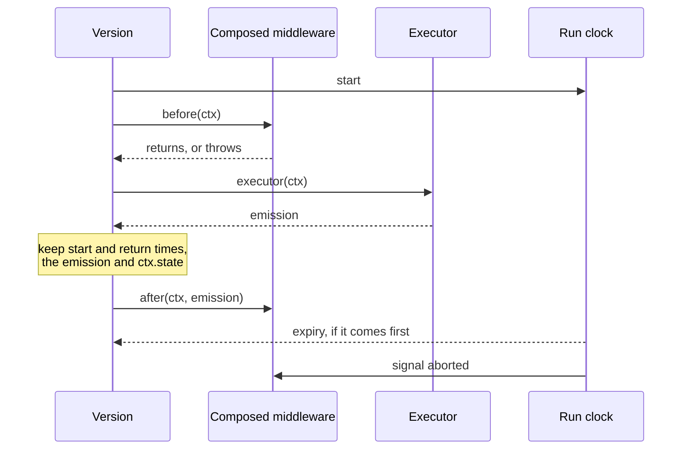

## Context

See proposal.md for why. Today the version calls `runMiddleware({ layers, ctx, executor, telemetry, middlewareProgress })`. That function runs the before parts, calls the executor, records its start time, return time and emission on the progress object, runs the after parts, and reports `returned` or `raised`. The version wraps its executor so that the record at the executor's return is captured on the way through, races the whole call against the run clock, and on expiry sets `outran` on the progress object so the chain stops.

## Goals / Non-Goals

**Goals:**
- The version reads as its steps: resolve, before, execute, after.
- Each rule of the chain lives in one place: stop at the first failing before part, run after parts in reverse, pass over a failing after part, stop once the clock has expired, and mark each part on the span.
- The executor and everything about it stay in the version.

**Non-Goals:**
- Any change in behaviour, metrics or faults, beyond the refusal order and the marks proposal.md lists.
- A public composite, or a composite placed inside a layer list.

## Decisions

### One async factory: resolve, then construct

```ts
const abortController = new AbortController();
const attempt = await tryCreateArvoComposedMiddleware({
  supplied: param.middleware,
  declared: this.#declaredMiddleware,
  abortSignal: abortController.signal,
});
if (!attempt.ok) throw await this.#faultFor(param, collectedRecord, refusalFrom(attempt.error));
const middleware = attempt.value;
```

The version makes one call and has one failure path. Inside, the factory does two steps in order and stops at the first that fails:

1. `tryResolveMiddleware` calls the factories;
2. the constructor checks the layers.

**`tryResolveMiddleware` has one job:** call each factory once and put what it returned in that entry's place. Factories can be async, so this step is async, which is why the whole factory returns an `AsyncResult`. It stays a function of its own, called only by the factory.

```ts
/** Every entry with each factory replaced by what it made, in the order given. */
export type ArvoResolvedMiddleware = {
  /** Resolved entries, or the value supplied when it was not a list: the constructor refuses that. */
  supplied: unknown;
  declared: readonly unknown[];
};

export const tryResolveMiddleware = async (
  supplied: unknown,
  declared: readonly ArvoEventHandlerMiddlewareEntry[] | null,
): AsyncResult<ArvoResolvedMiddleware, ArvoComposedMiddlewareResolutionError> => {
  const resolvedSupplied: unknown[] = [];
  const resolvedDeclared: unknown[] = [];
  const lists = [
    // not a list: passed through untouched, for the constructor to refuse
    { listName: 'supplied', entries: Array.isArray(supplied) ? supplied : [], into: resolvedSupplied },
    { listName: 'declared', entries: declared ?? [], into: resolvedDeclared },
  ];

  for (const { listName, entries, into } of lists) {
    for (const [entryIndex, middlewareEntry] of entries.entries()) {
      if (typeof middlewareEntry !== 'function') {
        into.push(middlewareEntry);
        continue;
      }
      try {
        into.push(await middlewareEntry());
      } catch (thrown) {
        // the first factory that throws stops resolution: later ones are not called
        return fromNeverthrow(
          err(new ArvoComposedMiddlewareResolutionError({ position: `${listName} middleware[${entryIndex}]`, thrown })),
        );
      }
    }
  }

  const suppliedWasAList = supplied === undefined || supplied === null || Array.isArray(supplied);
  return fromNeverthrow(ok({ supplied: suppliedWasAList ? resolvedSupplied : supplied, declared: resolvedDeclared }));
};
```

- **Supplied entries are made before declared ones,** one at a time, in the order given, as the layers will run.
- **Omitted and empty both resolve to an empty list.** Supplied middleware that is not a list comes back unchanged, and none of its entries is made.
- **It knows nothing about layers.** A factory that returns something that is not a layer is not its concern: the constructor refuses it.

**The constructor holds every rule about the layers:** supplied middleware must be a list, every entry must be a layer, and no two layers may share an identifier. It knows which list each entry came from, so its messages name `supplied middleware[i]` and `declared middleware[i]` exactly as today.

**The constructor reports every problem, in two passes,** following *Validation* in `project.md`:

1. **Shape.** Supplied middleware must be a list, and every entry, supplied and declared, must be a layer. Every failure is collected. If there is any, the refusal is `middleware_instantiation_failed`, and each issue carries a `blockingReason`: identifiers cannot be compared until every entry is a layer.
2. **Identifiers.** Only when every entry is a layer: every repeated identifier is collected, each naming both positions. If there is any, the refusal is `middleware_conflict`.

So one refusal lists every bad entry, or else every duplicate, never both: a duplicate cannot be judged among entries that are not all layers. Supplied middleware that is not a list blocks only its own positions; the declared entries are still checked.

**Each step has its own error, because each fails for a different reason.**

- **`ArvoComposedMiddlewareResolutionError`**: a factory threw. Nothing was checked; code failed. It carries the entry's position and what was thrown, as its `cause`, and its message names both, as today's does: `supplied middleware[1] is a way to make a layer, and calling it failed: <cause>. No layer ran`. Its fault kind is always `middleware_instantiation_failed`.
- **`ArvoComposedMiddlewareValidationError`**: the layers broke a rule. It follows `ArvoEventValidatorError`, which already does this job for events: it carries every issue, builds its message from them, and carries the fault kind it becomes, `middleware_instantiation_failed` for a shape problem or `middleware_conflict` for a repeated identifier.

`tryResolveMiddleware` returns the first as `Err`, the constructor throws the second, and the factory hands either back as its own `Err`. Both carry their fault kind, so the version raises the fault without deciding anything again: `refusalFrom` copies the fault kind and message, and renders the violations, the validation error's issues or the resolution error's one position, into the shape `#faultFor` already takes. Both carry a `_tag`, and both live in `composed-middleware/errors.ts`.

`refusalFrom` lives beside the version, in `src/ArvoEventHandler/version/middleware-refusal.ts`, not beside the composite: the refusal is the version's shape, so the composite's files know nothing of faults. It copies and decides nothing:

```ts
export const refusalFrom = (
  error: ArvoComposedMiddlewareResolutionError | ArvoComposedMiddlewareValidationError,
): ArvoGateRefusal =>
  error instanceof ArvoComposedMiddlewareResolutionError
    ? {
        faultKind: error.faultKind,                 // always middleware_instantiation_failed
        message: error.message,                     // names the position and what was thrown
        violations: [`${error.position}: ${describeThrown(error.cause)}`],
        cause: describeThrown(error.cause),
      }
    : {
        faultKind: error.faultKind,                 // middleware_instantiation_failed or middleware_conflict
        message: error.message,                     // built from every issue
        violations: error.issues.map((issue) => issue.toString()),
      };
```

`#faultFor` then passes the refusal to `createArvoHandlerFault`, unchanged: the fault gains the execution, the event it answers and the abandonment pair, and both kinds come out non-retryable because neither is among the kinds safe to retry. All of this happens before the context is built, so no layer part ran and the executor was not entered.

```ts
export const tryCreateArvoComposedMiddleware = async (
  param: ArvoComposedMiddlewareParam,
): AsyncResult<
  ArvoComposedMiddleware,
  ArvoComposedMiddlewareResolutionError | ArvoComposedMiddlewareValidationError
> => {
  const resolution = await tryResolveMiddleware(param.supplied, param.declared);
  if (!resolution.ok) return resolution;
  try {
    return fromNeverthrow(ok(new ArvoComposedMiddleware({ resolved: resolution.value, abortSignal: param.abortSignal })));
  } catch (thrown) {
    if (thrown instanceof ArvoComposedMiddlewareValidationError) {
      return fromNeverthrow(err(thrown));
    }
    throw thrown;
  }
};
```

Around the constructor, the factory follows `tryCreateArvoEvent`: only the validation error becomes `Err`, and anything else is a bug that goes up as it arrived. No throwing `createArvoComposedMiddleware` is added, because the constructor already is that form. The factory and the error live beside the class, not in `src/factories/`, since none of them is exported.

The version builds the composite before it builds the context, so a refusal still leaves nothing half-done.

**What a caller could notice.** Today each entry is made and checked before the next one. Now all of them are made first, and checked after. Three things follow:

| Situation | Today | After this change |
|---|---|---|
| The supplied middleware is not a list | Refused at once. No factory is called. | The handler's own factories are called first, then the execution is refused. |
| An early entry is not a layer, and a later entry is a factory | Refused at the early entry. The later factory is not called. | The later factory is called, then the execution is refused. |
| An early entry is not a layer, and a later factory throws | The early entry is reported. | The throwing factory is reported. |

Resolution stops at the first factory that throws, so the factories after it are not called.

One more difference: where several entries are wrong, today's refusal names only the first, and the new one names all of them. Its message is built from the issues, as every validation error in the package builds its message, so the wording changes too.

In every case the execution is still refused, it is not retried, and no layer part runs. The spec already describes this order: *A Layer, Or A Way To Make One* calls every factory before any layer runs, and applies the identifier rule to what they return.

*Alternatives considered:*
- **Keep the checks in `tryResolveMiddleware`** and build the composite from layers already known to be valid. Rejected: it leaves the rules about layers outside the class that runs them.
- **Call `tryResolveMiddleware` from the version, then a synchronous factory.** Rejected: the version would hold two calls and two failure paths for one step, building its layers.

### The composite itself leaves nothing in telemetry

Only the layers inside the composite are marked: each part's entered, returned and failed marks, by the layer's own `id`, with `middleware.aborted` saying whether the run clock had fired. The composite's `id` never appears in a mark, and calling the composite opens no span and records nothing of its own.

The middleware-duration metric measures time spent in layers. As today, it is recorded only where there is at least one layer. The version knows that from the resolved lists, so the composite needs no member to say it.

### The run clock reaches the composite as an `AbortSignal`

```ts
class ArvoComposedMiddleware implements IArvoEventHandlerMiddleware<'arvo.composed'> {
  readonly id = 'arvo.composed';
  constructor(param: {
    resolved: { supplied: unknown; declared: readonly unknown[] | null };
    abortSignal: AbortSignal;
  });                                    // throws ArvoComposedMiddlewareValidationError on a refusal
  before(ctx): Promise<void>;           // throws what a before part threw
  after(ctx, emission): Promise<void>;  // never throws
}
```

The constructor takes no telemetry. Every mark is made on `ctx.telemetry`, the same telemetry the version holds, since the context is built from it, and nothing is marked during construction.

The clock lives in the version, and the composite must notice it mid-chain. The version creates an `AbortController`, its timer calls `abort()`, and the composite checks `signal.aborted` before each part. The version reads the same signal wherever it needs to know the clock fired.

Every mark the composite makes carries the layer's `id` and whether the run clock had fired at that moment, read from the signal:

```ts
#markPart(ctx, stage: string, layer: IArvoEventHandlerMiddleware, extra = {}) {
  markStage(ctx.telemetry, stage, {
    'middleware.id': layer.id,
    'middleware.aborted': this.#abortSignal.aborted,
    ...extra,
  });
}
```

#### `before(ctx)`: in order, stopping at the first failure

```ts
async before(ctx) {
  for (const layer of this.#layers) {
    if (this.#abortSignal.aborted) return;           // clock fired: start nothing new
    if (layer.before === undefined) continue;        // a layer may have only an after
    this.#markPart(ctx, 'middleware_before_entered', layer);
    await layer.before(ctx);                         // a throw leaves here, unchanged
    this.#markPart(ctx, 'middleware_before_returned', layer);
  }
}
```

- **It catches nothing.** What a before part throws reaches the version exactly as thrown. A fault stays a fault, and anything else becomes the handler error, as if the executor had thrown it.
- **A failed part is marked entered and never returned.** That is how a reader of the trace sees where the chain stopped.
- **Once the signal is aborted, no further part starts.** A part already running finishes in the background. Its returned mark is still made, with `middleware.aborted` true, and nothing reads its result.

#### `after(ctx, emission)`: in reverse, never throwing

```ts
async after(ctx, emission) {
  const readOnlyEmission = Array.isArray(emission) ? Object.freeze(emission) : emission;
  for (const layer of [...this.#layers].reverse()) {
    if (this.#abortSignal.aborted) break;            // clock fired: the return already stands
    if (layer.after === undefined) continue;
    this.#markPart(ctx, 'middleware_after_entered', layer);
    try {
      await layer.after(ctx, readOnlyEmission);
      this.#markPart(ctx, 'middleware_after_returned', layer);
    } catch (thrown) {
      // a failing after part changes nothing: mark it and move on
      this.#markPart(ctx, 'middleware_after_failed', layer, describeThrown(thrown));
    }
  }
}
```

- **The emission is frozen,** so no after part can change what the executor returned. Only the array is frozen; the events in it are already immutable.
- **Each part's failure is caught on its own.** It is marked on the span, and the remaining after parts still run.
- **Every mark is made, whenever it happens.** A part that returns or fails after the clock fired is still marked, with `middleware.aborted` true, so the trace shows it finished late rather than hiding it. If the span has already ended by then, OpenTelemetry drops the mark without error. What the mark cannot do is change the outcome: the version settled that when the clock won.

#### What stays in the version

Calling the executor, its start and return times, and the record as the executor left it. So do the two marks that depend on those: `middleware_after_write_discarded`, which compares the record after the after parts with the one at the executor's return, and `middleware_after_cut`, which depends on who won the race. The composite knows nothing about the executor.

The signal is internal to the version and the composite. Whether layers themselves are given a signal is a separate question this change does not touch.

*Alternatives considered:*
- **A shared progress object passed into the constructor, as today.** Rejected: with the executor back in the version, the only state left to share is whether the clock fired.
- **A flag owned by the composite, set through `expire()` and read through `expired`.** Rejected: it adds a custom surface for what `AbortSignal` already says in a form every JavaScript reader knows. With the signal, the composite's surface is exactly the layer interface.

### The version holds the executor and races one function



The sketches below show the shape, not code to copy. The decisions above and the existing tests are what bind the implementation.

The function the clock races:

```ts
const run = async (): Promise<ArvoExecutorRun> => {
  try {
    await middleware.before(ctx);
    // the clock has already won the race; this only avoids entering the executor for nothing
    if (abortController.signal.aborted) return { kind: 'outran' };
    executorStartedAt = Date.now();
    emission = await this.#executor(ctx);
    returnedAt = Date.now();
    recordAtExecutorReturn = ctx.state;
  } catch (thrown) {
    return { kind: 'raised', thrown };
  }
  await middleware.after(ctx, emission);
  if (ctx.state !== recordAtExecutorReturn && !abortController.signal.aborted) {
    markStage(ctx.telemetry, 'middleware_after_write_discarded');
  }
  return { kind: 'returned', emission };
};
```

The race around it:

```ts
if (this.options.runTimeout === null) return await run();

let timer: ReturnType<typeof setTimeout> | undefined;
const clock = new Promise<ArvoExecutorRun>((settle) => {
  timer = setTimeout(() => {
    abortController.abort();                        // no part not yet started will run
    settle({ kind: 'outran' });
  }, this.options.runTimeout);
});

try {
  const executorRun = await Promise.race([run(), clock]);
  if (executorRun.kind !== 'outran') return executorRun;
  if (returnedAt !== null) {                 // fired during an after part
    markStage(ctx.telemetry, 'middleware_after_cut');
    return { kind: 'returned', emission };   // the executor's return stands
  }
  return executorRun;                        // fired during a before part or the executor
} finally {
  clearTimeout(timer);
}
```

The race decides the outcome, and the signal stops further work: a promise cannot be cancelled, so `run()` carries on in the background, but no layer part starts once the signal is aborted. `returnedAt` says where the clock fired, so the version knows whether the executor's return stands, exactly as today. The executor wrapper and `readRecordAtExecutorReturn` disappear, because the record is captured where the executor returns.

### Implements the layer interface, and stays internal

The composite implements `IArvoEventHandlerMiddleware`, with a fixed `id` of `arvo.composed`. The version then calls `before(ctx)` and `after(ctx, emission)` against the same signatures a user's layer has, so the type system holds the composite to the layer contract, and a change to the interface forces a change here. Its `after` is stricter than the interface requires, since it never throws, and a stricter implementation still satisfies the interface.

Two rules keep this safe, and both are recorded in the class's TSDoc:
- **It is never exported from `src/index.ts`.** A consumer cannot construct one, so a consumer cannot place one in a layer list.
- **It never appears inside a layer list.** The uniqueness check runs over the resolved layers, and the composite is built from them, never placed among them. Its own `id` therefore never meets the check.

If either rule is ever relaxed, the uniqueness check has to look inside composites, or inner identifiers would escape it. That is a decision for the change that relaxes the rule.

The version never calls `new` itself: it goes through `tryCreateArvoComposedMiddleware`, as consumers go through factories everywhere else in the package.

*Alternative considered:* a plain class that does not implement the interface, which removes the nesting question entirely. Rejected: the nesting question only arises if the composite becomes public, and the type-level guarantee is worth having now.

## Risks / Trade-offs

- [A before part still running when the clock fires keeps running in the background] → Unchanged from today. The protocol promises only that the execution no longer listens, and the aborted signal stops every later part.
- [Tests of `runMiddleware` are rewritten, so they could drift from what they checked] → Port each case one for one against the class, and require every test that runs through the public surface to pass without edits.
- [One more class where there was a function] → Accepted for the reading order it buys.
