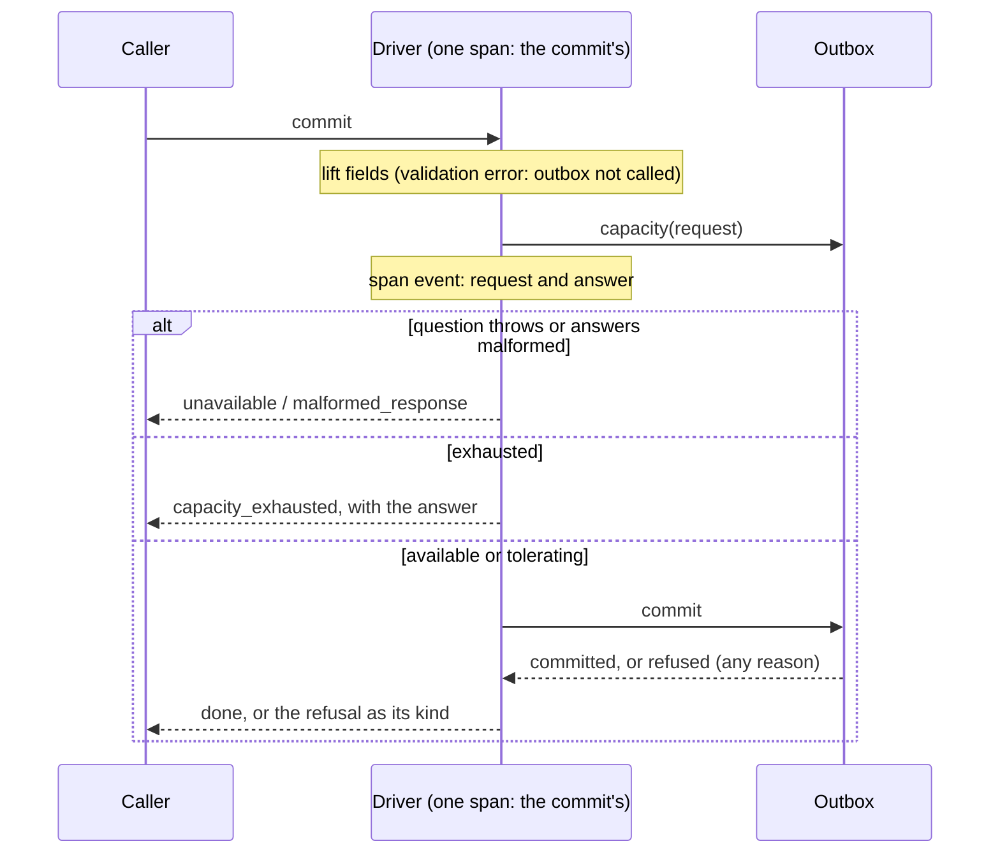

# Design

## Context

See proposal.md, **Why**. The interface lives in `src/ArvoOutbox/` (`interface.ts`, `types/`), the driver in `src/ArvoOutboxDriver/`. The driver already runs every operation through `runInSpan`, every outbox call through `callOutbox`, and checks a commit's answer with `checkCommitOutcome`.

## Goals / Non-Goals

**Goals:**

- The interface and the driver carry ADR-019's capacity and ADR-020's pre-commit check, fully typed and fully covered.

**Non-Goals:**

- Any outbox implementation or conformance check (proposal, **Deliberately not in scope**).
- Checking that the overall status really is the worst of the buffers. The driver checks shape, not the outbox's arithmetic.

## Decisions

### The types

New file `src/ArvoOutbox/types/capacity.ts`:

```ts
type ArvoOutboxCapacityRequest = {
  readonly events: number;                       // whole, zero or more
  readonly state?: { readonly casVersion: number };
};

type ArvoOutboxCapacityStatus = 'available' | 'tolerating' | 'exhausted';

type ArvoOutboxBufferCapacity = {
  readonly status: ArvoOutboxCapacityStatus;
  readonly held?: number;                        // with the request added
  readonly size?: number;                        // past this, tolerating
  readonly limit?: number;                       // past this, exhausted
};

type ArvoOutboxCapacity = {
  readonly status: ArvoOutboxCapacityStatus;     // the worst of the buffers
  readonly buffers: {
    readonly events?: ArvoOutboxBufferCapacity;
    readonly states?: ArvoOutboxBufferCapacity;
  };
};
```

`buffers`, not ADR-019's illustrative `kinds`: ADR-004 leaves names to the language, and "kind" already means the driver error's kind here.

In `types/commit.ts`:

```ts
type ArvoOutboxRefusal = 'state_exists' | 'revision_stale' | 'capacity_exhausted';

type ArvoOutboxEventsCommitOutcome =
  | { readonly committed: true }
  | { readonly committed: false; readonly refusal: 'capacity_exhausted' };
```

`IArvoOutbox` gains `capacity(request): PromiseAble<ArvoOutboxCapacity>`, and `commitEvents` now answers `PromiseAble<ArvoOutboxEventsCommitOutcome>`.

*Alternative:* `commitEvents` keeping `void` and only throwing for lack of room. Rejected: ADR-019 rule 23 now forbids throwing for it.

### The driver's capacity

```ts
type ArvoOutboxDriverCapacityParam =
  | ArvoOutboxDriverCommitStateAndEventsParam    // → { events: n, state: { casVersion } }
  | ArvoOutboxDriverCommitEventsParam            // → { events: n }
  | ArvoOutboxDriverCallParam;                   // → { events: 1, state: { casVersion: 0 } }

tryCapacity(param?: ArvoOutboxDriverCapacityParam): AsyncResult<ArvoOutboxCapacity, ArvoOutboxDriverError>;
capacity(param?: ArvoOutboxDriverCapacityParam): Promise<ArvoOutboxCapacity>;
```

The param is the commit param itself, so a caller asks with exactly what it would commit. It is told apart by `'state' in param`, then `'events' in param`. The "nothing" case is a bare call param, so it can still carry telemetry.

The record's `casVersion` is taken with the existing `liftCommitFields`, so a record the commit would reject is rejected here the same way, by `ArvoOutboxDriverValidationError`, before the outbox is called. The event count is `events.length`: the driver removes no duplicates, so it counts none away.

A new helper `build-capacity-request.ts` maps the param to the request, and `check-capacity.ts` checks the answer: a known status overall; `buffers` an object; each buffer given has a known status and, where given, `held`, `size` and `limit` whole numbers zero or more. The statuses are one frozen array checked with `includes`.

### Asking before every commit



Order inside each commit: lift the fields, ask, then build the event records and commit. Asking before building spends no serialization on a commit that will be stopped.

The question goes through a private `#askCapacity(request, operationName)` that calls `callOutbox` and `checkCapacity` with the commit's operation name, so a failed question is reported as the commit's failure. The standalone `tryCapacity` runs the same method inside its own `runInSpan`.

### Recording the question on the commit's span

`runInSpan`'s `run` is given the span it opened: `run: (span) => …`. The commit adds one span event, `capacity`, with the request's event count, its `casVersion` where given, and the answer's status, or that the question failed. The event's name and attributes are API shape (ADR-020, **Left deferred**).

*Alternative:* a child span for the question. Rejected: ADR-020 says the question opens none.

### The error

- `ArvoOutboxDriverErrorKind` gains `capacity_exhausted`, with its meaning in `meaningOfKind`.
- `ArvoOutboxDriverErrorParam` gains `capacity?: ArvoOutboxCapacity`, and the error gains `readonly capacity: ArvoOutboxCapacity | null`. That is the answer where the question stopped the commit, and `null` where the outbox refused at commit, since no answer was given then.

### Checking commit outcomes

`checkCommitOutcome` takes the refusals it accepts: one frozen array for the commit with a record (all three), and one for events alone (`capacity_exhausted` only). Its issue message names the refusals accepted.

## Risks / Trade-offs

- [The build is red between this change and the next] → Agreed with the developer. The tests for `src/ArvoOutbox` and `src/ArvoOutboxDriver` are run by path, and coverage is judged on those two folders. The next change restores the full suite.
- [Every commit now makes two outbox calls] → Accepted by ADR-020. How fast `capacity` answers is the outbox's choice.
- [A question can be overtaken] → Accepted by ADR-019 rule 24. An outbox that must keep its limit refuses at commit, and the driver reports that as `capacity_exhausted` too.
- [Breaking `IArvoOutbox` and `commitEvents`] → The package is unreleased on this branch, and every implementer in the repository is fixed by the next change.

## Migration Plan

For a developer's outbox, add `capacity`. An outbox that limits nothing answers `{ status: 'available', buffers: {} }`. Then make `commitEvents` return `{ committed: true }`.
