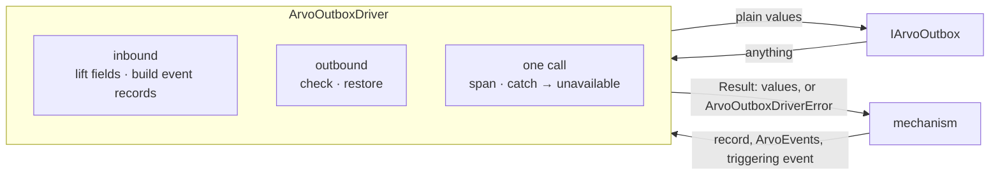

## Context

See proposal.md, *Why*. The outbox exists: `IArvoOutbox`, its types, and two outboxes, each opened and closed through `ArvoOutboxLifecycle`. What a handler hands on is `ArvoEventHandlerExecuteResponse`: on `produced`, the next execution record as a `JSONObject` and the live `ArvoEvent`s. `ArvoEventSerializer` already writes an `ArvoEvent` as CloudEvent JSON and reads one back; `walkPayload` already checks a value is a JSON object at every depth; `resolveTelemetry` already resolves a tracer per call. The requirements are in `specs/outbox-driver/spec.md`.

## Goals / Non-Goals

**Goals:**

- One driver that builds, checks, restores and reports for any outbox, so nothing else in Arvo touches one.
- Errors that tell a lost race from an outage from a defect, in the package's `tryX`/`X` idiom.
- Nothing new written where something in the package already does the job.

**Non-Goals:**

- The handler's state function built from the driver's read, the mechanism's policy per kind, and a driver conformance kit: each deferred by ADR-020.
- Leasing, retention or any other outbox behaviour: the driver passes `leaseMs` through and decides nothing about it.

## Decisions

### Where everything sits



```
src/ArvoOutboxDriver/
  index.ts                         ArvoOutboxDriver
  types.ts                         the param of each operation, and the read entry { record, event }
  errors.ts                        ArvoOutboxDriverError and its kinds; ArvoOutboxDriverValidationError
  helpers/
    lift-commit-fields.ts          the six fields off a record, or every issue
    build-event-record.ts          an ArvoEvent to the event record that stores it
    check-state.ts                 a state read's answer, or malformed_state
    check-commit-outcome.ts        a commit's answer, or malformed_response
    check-committed-records.ts     a read's answer, or malformed_response / malformed_event
    restore-event.ts               a payload back to an ArvoEvent, strictly, or malformed_event
    call-outbox.ts                 one call in its span, anything thrown as unavailable
```

### Built with `new`, holding one outbox

`new ArvoOutboxDriver({ outbox })`: a long-lived object configured once, the same exception the outboxes and serializers take. It holds the outbox and nothing else. Telemetry is not held: each operation's param takes an optional `telemetry`, resolved when called, as the handler and the dispatcher already do.

`open()` and `close()` forward to the outbox, as `tryOpen`/`open` and `tryClose`/`close`, since ADR-020 has the driver be the only caller; a throw from either is `unavailable`. The driver keeps no lifecycle of its own: whether the outbox is open is the outbox's to say, and saying it twice would be two answers to one question.

### Every operation is a `tryX`/`X` pair over one call

Each `tryX` does its work in one place: check the input, build what the outbox receives, call the outbox once in its span, check the answer, and answer `AsyncResult<…, ArvoOutboxDriverError>`. Each `X` only unwraps. Results are built with neverthrow's `ok`/`err` through `fromNeverthrow`.

`call-outbox.ts` holds what every call shares: open a span named for the operation as a child of the active context, `await` the outbox, turn anything thrown into `unavailable` with the thrown value as cause, mark the span, end it in a `finally`.

### Inbound: lifting and building

The record is the handler's `JSONObject`. `lift-commit-fields.ts` reads `executionId`, `subject`, `source`, `version` and `lifecycle` as non-empty strings and `casVersion` as a whole number at least zero, collecting an `ErrorIssue` for each one missing or mistyped; any issue throws `ArvoOutboxDriverValidationError`, before the outbox is called. The record is passed to the outbox as given.

Considered: taking an `ArvoExecutionState` rather than the document. Rejected because the handler hands on the document, and parsing it into a state needs the owning version's data schema, which the driver does not have and should not.

`build-event-record.ts` writes the event through `ArvoEventSerializer`'s CloudEvent mode and maps the event's own fields: `id`, `subject`, `executionid` → `executionId`, `parentid` → `parentId`, `initid` → `initId`, `source`, `type`, `to`, `domain`, `time`. `triggeringEventId` is the delivered event's `id`; `casVersion` is the record's, or `null` for `commitEvents`. A failure to serialize one of Arvo's own events is a defect in it, so it throws, as the serializer's own error.

### Outbound: checking and restoring

- **A state read:** `walkPayload` decides whether the answer is a JSON object at every depth; `null` passes. Its issues are the cause of `malformed_state`. The answer is handed on as the outbox gave it.
- **A commit outcome:** `{ committed: true }`, or `{ committed: false, refusal }` with one of the two refusals. A refusal becomes its kind; anything else is `malformed_response`.
- **A read of events:** not an array is `malformed_response`. Each record is checked field by field against `ArvoOutboxCommittedEventRecord`, and one wrong is `malformed_event`, as ADR-020 places a record lacking a field.
- **Restoring:** `ArvoEventSerializer.tryDeserialize` with no foreign fallback. The first task proves it is strict, refusing a payload that is not JSON and a CloudEvent that is not Arvo-shaped; only if it is not does a strict path get built. A payload that will not restore is `malformed_event`, its cause the serializer's error. Off, records come back with `event: null`, and payloads are not read.

### The read entry

`ArvoOutboxDriverEventEntry` is `{ record: ArvoOutboxCommittedEventRecord; event: ArvoEvent | null }`: one shape however the read was made, `event` absent only where restoring was turned off. Considered: overloads typing `event` by the flag. Rejected because the flag defaults, and an overload on an optional boolean types the common call worst.

### Two errors

`ArvoOutboxDriverError` carries `_tag`, `kind`, `operationName` and `cause`, with a message naming the operation, the kind and what to do, after `ArvoOutboxLifecycleError`. `ArvoOutboxDriverValidationError` carries `_tag` and every `issues`, after `ArvoDispatcherValidationError`. The first is answered or thrown by every operation; the second is only thrown, since it is the caller's bug and never the outbox's answer.

## Risks / Trade-offs

- **[Every read restores every payload]** → Restoring may be turned off per read, as ADR-020 provides for the sweeper.
- **[A record's other fields are not validated]** → Deliberately: the driver lifts six fields and passes the record whole; validating it is the handler's, which built it.
- **[A state is walked at every depth on every read]** → Small beside the outbox call, and ADR-020 accepts the cost.
- **[`unavailable` hides which storage error it was]** → The cause carries it unchanged.

## Migration Plan

None: the driver is new, and nothing yet calls an outbox.
