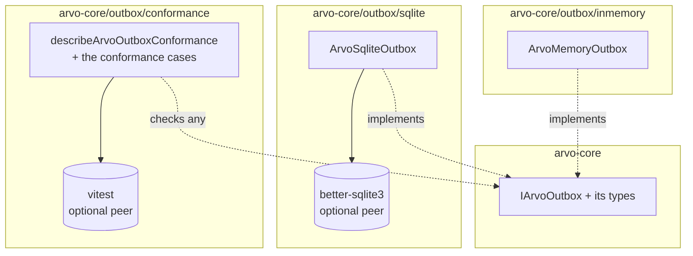
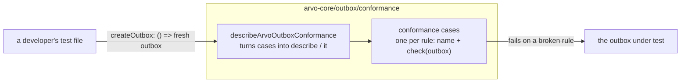
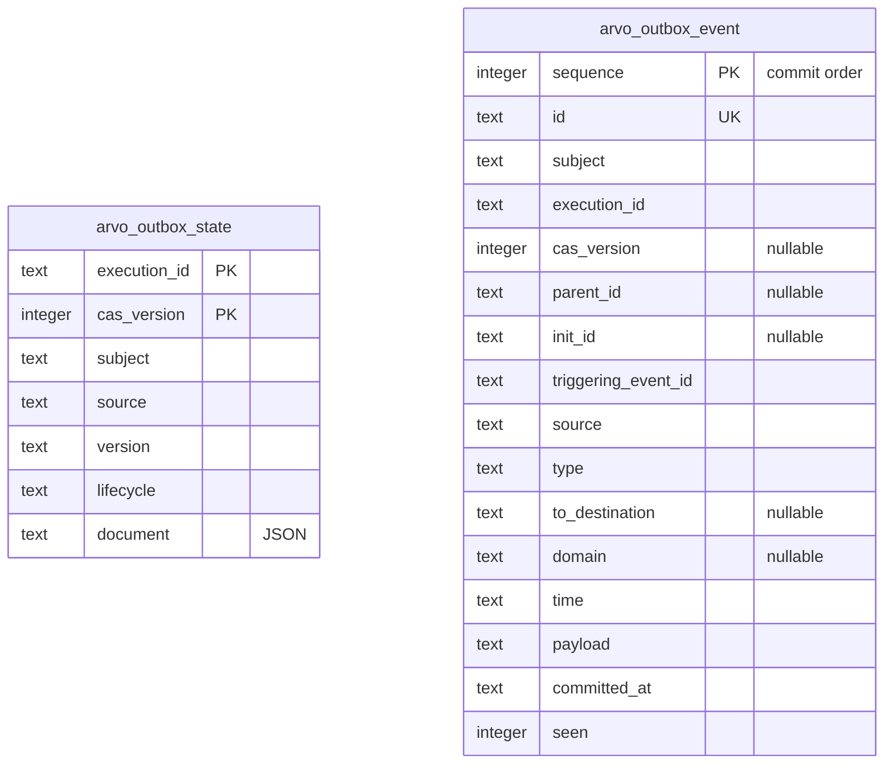

## Context

See proposal.md, Why. [ADR-019](../../../../../docs/adr/019-outbox.md) fixes the outbox's data model, its operations and every rule an implementation must meet, and leaves API shape to each language ([ADR-004](../../../../../docs/adr/004-multi-language-implementation-governance.md)). This document settles that shape for TypeScript, and how Arvo's own two outboxes meet the rules.

The audience of everything shipped here is a developer who installed `arvo-core` and is either implementing an outbox against their own storage or picking one of Arvo's. They have not read the ADRs. The interface, its types, the outboxes and the kit, and their TSDoc, have to be enough on their own.

## Goals / Non-Goals

**Goals:**

- An interface a developer can implement from its TSDoc alone, against any storage, with no Arvo types beyond `JSONObject`.
- A conformance kit that holds any outbox to every rule that does not need a controlled clock, and that is itself proven to catch each broken rule.
- Two production-grade outboxes: one in memory for one process, one in a SQLite file for one machine.
- Entry points so that a consumer loads only what they import.

**Non-Goals:**

- The driver of [ADR-020](../../../../../docs/adr/020-outbox-driver.md), and anything a mechanism does.
- Validating what reaches an outbox. ADR-019 has an outbox trust its caller and judge nothing; checking is the driver's.
- Retention, leasing, and outboxes for database servers. See proposal.md, Not in scope.

## Decisions

### Entry points



| Entry point | Holds | Needs beyond the package's own dependencies |
|---|---|---|
| `arvo-core` | `IArvoOutbox` and every type that crosses it | nothing |
| `arvo-core/outbox/inmemory` | `ArvoMemoryOutbox`, `ArvoMemoryOutboxOptions` | nothing |
| `arvo-core/outbox/sqlite` | `ArvoSqliteOutbox`, `ArvoSqliteOutboxOptions` | `better-sqlite3` |
| `arvo-core/outbox/conformance` | the conformance kit | `vitest` |

The interface and types stay on the main entry because every outbox, the driver, and a developer's own outbox all need them, and they bring no dependency. Each outbox, and the kit, has its own entry point under `outbox/`, so that the dependencies each brings are paid only by those who import it, so that the package reads as a choice of outboxes with their test beside them, and so that a later driver kit can sit under its own name without crowding this one. Each entry point's source folder matches its export path.

### Plain methods on the interface, promises from Arvo's outboxes

project.md makes every fallible operation in arvo-core a `tryX` / `X` pair. That rule governs operations arvo-core implements and a consumer calls. `IArvoOutbox` is the opposite: a consumer implements it and arvo-core calls it. ADR-019 requires its operations to be plain — return values, throw what the storage throws — so that an implementer never builds an Arvo result or error. `IArvoEventHandlerDependency` and `IArvoEventHandlerMiddleware` take this shape already, and their TSDoc says `@throws Anything` and what follows.

The interface's return types are `PromiseAble`, so a developer's outbox may answer directly. Arvo's own two outboxes always return a promise, so that a caller of either sees one way of answering.

Considered: `tryX` methods on the interface. Rejected because it asks every implementer to understand `Result` and to classify their storage's failures, which ADR-019 and ADR-020 keep away from them.

### Names, mapped from the ADR

ADR-019's names are snake_case, the model's own. arvo-core spells them in camelCase, as it does for the execution record.

| ADR-019 | Here |
|---|---|
| `read_latest_state`, `commit_state_and_events`, `commit_events` | `readLatestState`, `commitStateAndEvents`, `commitEvents` |
| `read_committed_events`, `list_unseen_events`, `mark_events_seen` | `readCommittedEvents`, `listUnseenEvents`, `markEventsSeen` |
| `execution_id`, `cas_version`, `parent_id`, `init_id`, `triggering_event_id`, `committed_at` | `executionId`, `casVersion`, `parentId`, `initId`, `triggeringEventId`, `committedAt` |
| `at_most`, `older_than` | `atMost`, `olderThanMs` |

The types are named for what they hold:

| Type | What it is |
|---|---|
| `IArvoOutbox` | the interface a developer implements |
| `ArvoOutboxEventRecord` | one event as an outbox is given it to keep |
| `ArvoOutboxCommittedEventRecord` | one event as an outbox hands it back, with the two fields the outbox owns |
| `ArvoOutboxStateCommit` | everything one commit of a state and its events writes, flat |
| `ArvoOutboxEventsCommit` | everything one commit of events alone writes |
| `ArvoOutboxCommitOutcome` | committed, or refused with the refusal |
| `ArvoOutboxRefusal` | `state_exists` or `revision_stale` |
| `ArvoOutboxEventsFilter` | one execution, one delivery, or both |
| `ArvoOutboxUnseenEventsParam` | how many to list, and how recent is too recent |

The filter is a union of its three shapes, so an empty filter is a compile error and "read everything" cannot be asked for by accident.

### Times

`committedAt` is a string in the same form as an event's `time`: an RFC 3339 instant in UTC, as `Date.prototype.toISOString` writes it, so that two such strings compare in time order as strings. `olderThanMs` is a number of milliseconds, as every other duration in the package is.

### The conformance kit



- **Cases are plain.** Each case is a name and a function that takes an outbox and fails, through vitest's `expect`, where the outbox breaks the rule. The list of cases is exported, so they can be wired into another runner.
- **One function turns them into a suite.** `describeArvoOutboxConformance({ createOutbox })` registers one `describe` and one `it` per case, calling `createOutbox` afresh for each. A developer's whole test file is that call.
- **A fresh, empty outbox per case.** Listing unseen events looks across everything an outbox holds, so a case can reason about order and limits only if nothing else is in it. The TSDoc says so: a new in-memory instance, a new file, or a new schema per call.
- **Unique identifiers.** Every case generates its own identifiers, so a case never depends on what another wrote.
- **No clock control.** An outbox stamps times by its own clock. The kit checks what any clock gives — a valid instant, one time for every event of one commit, unseen events in the order committed, a cut-off far in the past lists everything and one far in the future nothing — and leaves the exact boundary to the in-memory outbox's own tests, which set the clock.
- **The kit is proven by breaking things.** Every case runs against `ArvoMemoryOutbox` and must pass, and against an outbox broken in exactly the way that case guards and must fail. A case that passes a broken outbox is a defect in the kit.

### What "production grade" and "async safe" require of Arvo's outboxes

Both of Arvo's outboxes are meant to be run, not only tested. Each must:

- **Meet every rule,** proven by the kit.
- **Do constant work per call however much it holds.** Every read goes through an index: by execution, by delivery, and over unseen events in landing order. Nothing scans everything.
- **Answer overlapping calls as if each were alone.** JavaScript switches between tasks only at an `await`, so each operation does every check and every write in one stretch with no `await` inside it. Two commits racing for one revision leave exactly one committed. A read overlapping a commit sees all of it or none of it.
- **Never half-fail.** Everything that can throw on the way in, such as copying an input, happens before anything is written.
- **Hold its own copies.** Nothing a caller passes in or reads out shares memory with what is stored.
- **Say its limits in its first sentence.** The in-memory outbox loses everything with the process; the SQLite outbox is for one machine.

### `ArvoMemoryOutbox`

- **Built with `new`.** A long-lived object configured once and reused, the same category as the serializers, the package's existing exception to building through a factory.
- **One option, `clock`.** A function returning the current time, defaulting to the system clock. Tests set it; nothing else needs it.
- **Three indexes beside the data.** Every revision of every state, by execution. Every event record, by its identifier. Two lookups from execution and from delivery to their event identifiers. And the unseen events kept in landing order, so listing them reads from the front and marking one seen removes it.
- **Copies in and out** with `structuredClone`, made before any write.
- **A commit is one synchronous stretch:** copy, check the revision, stamp one time, write everything. Nothing awaits inside it.
- **Ties keep commit order.** Two events landing at the same time are listed in the order they were committed, so the events of one commit keep their order.

### `ArvoSqliteOutbox`



- **Built on `better-sqlite3`.** The established SQLite library for Node, supporting every Node version the package does, with a synchronous API. Synchronous is an advantage here: a whole commit runs as one stretch that no other call in the process can interleave.
- **Opened on a file name.** `new ArvoSqliteOutbox({ filename })` opens the file, turns on write-ahead logging so readers do not wait on writers, sets how long to wait for a file held by another writer, and creates its two tables and their indexes where missing. It holds the file until `close()`, which may be repeated; any operation after it throws. The library's own types stay private, so a consumer's types need nothing from it.
- **A commit is one immediate transaction.** It takes the file's write lock before it reads the stored revision, so no other process can write between the check and the insert. The revision check, the state insert, every event insert and the landing time all happen inside it.
- **The database's clock.** The landing time is read from SQLite once per commit, inside the transaction, in the same form as an event's time. The unseen cut-off is computed by SQLite too.
- **Duplicates by the database.** An event insert that meets an existing identifier does nothing, by the table's own uniqueness.
- **Indexes** on execution, on delivery, and on unseen events in landing order then commit order.
- **Several outboxes on one file stay correct.** SQLite's write lock serializes their commits. A writer held beyond the wait throws, which is the outbox being unable to do its work.

Considered: Node's own `node:sqlite`. Rejected for now. Node's own documentation lists it at *Stability 1.1, active development* in Node 22, which the package supports, where it warns on every process that loads it, and at *Stability 1.2, release candidate* from Node 24.15; it is stable in no Node line yet, and its API is still changing. Revisit once Node marks it stable and every Node version the package supports carries that status.

Considered: taking an open database from the caller rather than a file name. Rejected because it would put the library's types on the public surface and leave the outbox unsure the database was configured as it needs.

### Dependencies

Under project.md's *Dependencies and reuse*, a new dependency is a cost every consumer bears. Both are optional peers, each imported by one entry point only, so the cost falls only on those who import that entry point, who need it anyway.

| Dependency | Why | How it is declared | Version |
|---|---|---|---|
| `vitest` | the kit registers its suite with it | optional peer; development dependency already | peer `^5.0.0`, development the latest stable `5.0.5` |
| `better-sqlite3` | the SQLite outbox is built on it | optional peer; development dependency | `^13.0.3`, the latest: built on Node's stable native interface, with prebuilt binaries bundled |
| `@types/better-sqlite3` | `better-sqlite3` ships no types of its own | development dependency only, since the library's types never reach the public surface | `9.6.0`, the latest |

Versions were checked against the registry when this change was written, not taken from memory, and are re-checked when the dependencies are installed.

**No package for async safety in memory.** JavaScript runs one task at a time and switches only at an `await`, so an operation with no `await` between its checks and its writes cannot be interleaved. A lock library is needed only where an operation must await partway through, which neither outbox does. Copies use the built-in `structuredClone`.

A test checks the built main entry point and the in-memory entry point import neither.

### One concern per file

```
src/ArvoOutbox/
  interface.ts                       IArvoOutbox
  types/
    event-record.ts                  ArvoOutboxEventRecord, ArvoOutboxCommittedEventRecord
    commit.ts                        ArvoOutboxStateCommit, ArvoOutboxEventsCommit,
                                     ArvoOutboxCommitOutcome, ArvoOutboxRefusal
    read.ts                          ArvoOutboxEventsFilter, ArvoOutboxUnseenEventsParam
src/outbox/conformance/
  index.ts                           the kit's entry point
  types.ts                           the case type and the suite's param
  cases/                             one file per requirement's checks
  describe.ts                        describeArvoOutboxConformance
src/outbox/inmemory/
  index.ts                           the entry point
  outbox.ts                          ArvoMemoryOutbox
  types.ts                           ArvoMemoryOutboxOptions
  helpers/
    refusal-for.ts                   which refusal, if any, a commit meets
src/outbox/sqlite/
  index.ts                           the entry point
  outbox.ts                          ArvoSqliteOutbox
  types.ts                           ArvoSqliteOutboxOptions
  schema.ts                          the tables and indexes it creates
  statements.ts                      the statements it prepares
```

Tests mirror it under `tests/`.

### TSDoc

Written to the package's rules: what a thing is, what may be passed, what will happen; no provenance; no concrete values or counts; every `@example` calls the symbol it sits on. On `IArvoOutbox` and each method, the rule an implementer meets and that it may throw; the interface's `@example` is a class implementing it. On each outbox, its limit in the first sentence. On the kit, that each call of `createOutbox` must return a fresh, empty outbox. Where a rule turns on a protocol value, such as the revision that marks an execution's first state, the TSDoc states the rule and cites the ADR rather than spelling the value.

## Risks / Trade-offs

- **[A conformance case passes an outbox that breaks its rule]** → Every case is run against an outbox broken in exactly that way, and must fail.
- **[`ArvoMemoryOutbox` is used as durable storage]** → Its first sentence says it loses everything with the process.
- **[`better-sqlite3` is a native module and fails to install on some platform]** → It is an optional peer, needed only by those importing the SQLite outbox; the rest of the package is unaffected.
- **[Several sweepers on one SQLite file send the same events]** → Correct by ADR-019, since receivers drop repeats; the TSDoc says the outbox is meant for one sweeper per file, and a lease is a later change.
- **[vitest's next major changes `describe` or `expect`]** → The peer range names the major the kit is written for.

## Migration Plan

New surface only. Nothing to migrate, nothing to roll back beyond reverting the change's commits.
