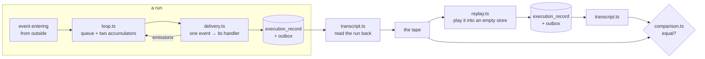

# The tape recorder

The third mechanism, and the only one with no framework in it.

Its whole purpose is to answer one question: **is the record the memory?**
If a handler given its record and its event comes to the same place every
time, then nothing that carries a run forward matters — and a mechanism
is free to be Temporal, or DBOS, or this.



## Why there is no framework here

Everything the framework-backed mechanisms give you — durable execution,
retry policies, histories — is a way of carrying a run forward across a
failure. Take all of it away and a run can only be carried forward by
what was committed. So if a run completes here at all, the record was
sufficient; and if a replay of it comes out the same, the record was
sufficient *and* the handler read nothing else.

That makes this the control. A difference between the two framework
adapters is the adapter's; a difference here is the handler's.

## The three pieces

| File | What |
|---|---|
| `delivery.ts` | One event to its handler, and whatever it produced committed. The same work the Temporal activity does. |
| `loop.ts` | The run: one queue of work, two accumulators, routing on `to`. Decides nothing about an execution. |
| `transcript.ts` | A finished run described **from the database**, never from memory. |
| `replay.ts` | A tape played back through a handler that knows nothing of the run that made it. |
| `comparison.ts` | What two runs must agree on, and the three things they need not. |
| `clear.ts` | Nothing of the last run left alive — its records and the handlers' own data. |

## The thing that is easy to get wrong

A replay cannot be driven by chaining its own commits.

An execution waits on the identifiers of the events it emitted. A handler
mints those, and the protocol never asked it to mint the same ones twice
— that is exactly why a recovered delivery republishes the bytes it
committed rather than asking an executor to produce them again. So a
replay that fed the parent its own newly-minted requests and then handed
it the *taped* answers would be handing it answers to questions it never
asked, and the parent would refuse them. Correctly.

So each delivery is given the record the tape says it read:

```
read from the tape  →  deliver  →  commit to the store
```

That asks precisely what the protocol promises — a handler given its
record and its event comes to the same place — and nothing more.

## What a replay is held to, and what it is not

Three things are set aside, each because nothing promised them:

- an event's `id` and `time`, minted per event by whoever built it
- the trace it travelled on, which belongs to the run and not the decision
- the identifiers of events a record **emitted**, which are those same
  minted values seen from the record's side

The identifiers of events a record **received** are compared, because a
replay is delivered the very events the run was.

Order within one commit is also set aside: the outbox has no ordinal, so
events committed together come back ordered by identifier, and no
mechanism is obliged to publish them in any order. Which revision an
event belongs to **is** compared, that being a decision.

## Running it

Needs the stack up and migrated — see [`../temporal/README.md`](../temporal/README.md).

```sh
pnpm distributed:up
pnpm distributed:migrate
pnpm vitest run tests/distributed/replay
```

Nothing else has to be running. There is no worker.
